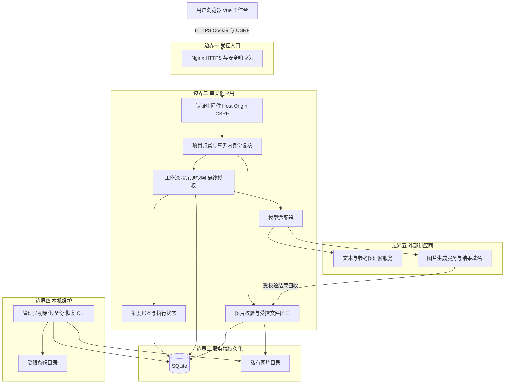
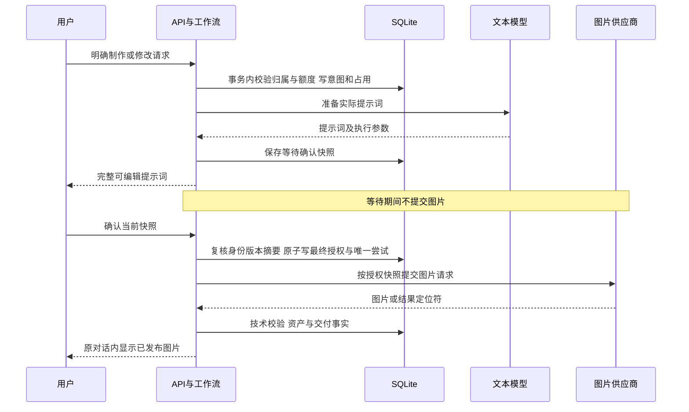

# 电商生图智能体安全架构专项设计说明书

| 文档属性 | 内容 |
| --- | --- |
| 文档版本 | 1.0 |
| 编制日期 | 2026年11月11日，Asia/Shanghai |
| 项目名称 | 电商生图智能体 |
| 对应应用版本 | package.json 声明为 0.1.0；需求演进至 v3 |
| 代码基线 | 扫描时 HEAD 为 `1a200a5407fafb72b6b95da80bf024caf987eeba`，工作区存在未提交变更 |
| 文档性质 | 当前实现说明、安全专项设计、差距与验收要求；不替代发布验收或渗透测试报告 |
| 适用读者 | 项目开发者、架构评审者、测试人员、部署维护者 |

本系统面向个体电商商家和小型团队，将自然语言需求及可选参考图转换为可下载的商品视觉图片。安全架构围绕多账号个人工作区、第三方模型调用、图片文件处理和可计费任务执行展开。核心原则是：身份与项目权限由后端决定，实际生图由用户确认的不可变提示词快照授权，异常恢复沿用原任务事实，数据库与文件通过受控维护流程备份和恢复。

源码中已有上述主要控制的实现。但默认工作流不执行独立模型内容审查，供应商下载的网络边界与内存预算仍有加强空间，目标设备上的部署与恢复效果也需要独立验收。本文把已有控制和后续要求分别标注，不据此宣称系统已经达到某项安全认证或适合直接暴露公网。

## 1 编制范围与证据规则

### 1.1 扫描范围

本次审阅覆盖以下资料：

- 原始场景与痛点说明，`version/v1`、`version/v2`、`version/v3` 需求资料。
- v3 总体架构、工作流门禁、提示词确认、前端设计与近期链路修订记录。
- `main/src` 前端及 `main/backend/app` 后端，身份、权限、供应商适配、任务账本、文件、审计与维护模块。
- Docker、Nginx、依赖声明、数据库迁移，以及根目录和 `backend/tests` 中相关现有测试。
- `docs/operations` 与 `docs/acceptance` 中历史运维和验收记录。

本次没有读取真实 `.env`、私有数据库、会话凭证或用户图片；没有调用真实付费模型、修改运行数据、执行恢复切换或实施攻击性测试。外部安全原则参照第18节列出的 OWASP 官方资料。

### 1.2 状态表达

| 标记 | 含义 | 能证明的范围 |
| --- | --- | --- |
| 已实现 | 本次在当前源码中找到控制逻辑 | 代码存在；具体环境效果仍取决于配置与测试 |
| 已验证 | 本次命令执行获得明确结果 | 仅限第15节列出的命令和覆盖范围 |
| 历史证据 | 仓库已有验收或审查记录 | 证明记录所述历史基线，不自动代表当前工作区 |
| 待补强 | 本文提出的目标控制或需要收敛的实现差距 | 尚不能作为已交付成果 |
| 待现场验收 | 依赖目标主机、证书、网络、模型或实际设备 | 需要部署维护者补充环境证据 |

`main/` 是应用交付根；根目录 `backend/` 同时承担开发依赖、测试和工作区运行配置等职责。应用源码以 `main/backend/app` 为准，不能因为存在两个 backend 目录就推定有两套生产服务。`vesion/` 为并存历史资料；本文依据根 AGENTS.md 指向的 `version/v3/SRS_v3.md` 及当前代码核对，不把重复目录当成额外版本。

### 1.3 需求冲突处理

v1 描述本机单用户最小闭环，v2 增加多阶段产物与审查，v3 增加受控局域网、多账号、归属、额度及正式运维能力。近期修订又将模型角色合并为四个，并简化内容审查及交付停点。

当前代码的默认设置为 `workflow_role_policy="collaborative"`、`workflow_gate_mode="off"`。结合 `stages/s07.py`、`prompt_preparation.py`、`final_confirmation.py` 与现行门禁文档顶部修订，可以确认：**准备提示词后仍须等待用户最终确认，关闭独立内容审查不等于允许自动提交图片。** 部分模块注释、DAG 元数据和旧文档仍保留自动执行或多重审批描述，不能单独作为现行行为依据。

## 2 安全目标与需求承接

| 安全目标 | 业务含义 | 主要需求来源 |
| --- | --- | --- |
| 身份可信 | 无默认管理员密码，禁用或撤销及时生效 | V3-ACC、V3-PWD、V3-SES |
| 工作区隔离 | 用户只访问自己的项目、消息、图片和历史 | V3-ACL |
| 执行授权一致 | 点击确认所见提示词与实际提交请求一致 | V3-GEN、提示词确认契约 |
| 调用成本受控 | 重放不重复计数，额度与占用持久化 | V3-LIM |
| 故障不扩大 | 超时和重启不触发无依据重发 | V3-GEN、恢复设计 |
| 敏感信息受控 | 密码、Key、会话与私有素材不进入公共出口 | V3-SEC、V3-DATA |
| 可追溯与可恢复 | 安全操作有记录，备份恢复不复活旧授权 | V3-AUD、V3-OPS |

安全设计服务于受信任维护者管理的单实例及受控局域网部署。主机管理员、容器宿主机与操作系统属于信任基础；当前方案不抵御已完全控制宿主机的攻击者，也未实现跨组织的强多租户隔离。

## 3 资产与数据分级

| 资产 | 建议级别 | 存放或使用位置 | 控制重点 |
| --- | --- | --- | --- |
| 密码哈希、会话摘要、一次性链接摘要 | 高敏感 | SQLite 账号与认证表 | 最小访问、生命周期与恢复撤销 |
| 模型供应商 API Key | 高敏感 | 服务端环境变量或 `.env` | 不进入前端、日志、源码、分发包 |
| TLS 私钥与主机维护权限 | 高敏感 | 部署主机受限目录 | 文件权限、只读挂载、轮换 |
| 原始商品图、对话、卖点与提示词 | 业务私有 | 数据根及项目表 | 项目归属、第三方传输边界 |
| 生成图片与历史版本 | 业务私有 | 资产文件及发布记录 | 经授权 API 读取，绑定原始快照 |
| 安全审计与任务账本 | 受限 | SQLite | 保留、最小披露、防止业务绕过 |
| 静态网页与公开健康状态 | 可公开 | 前端构建目录、健康接口 | 与用户文件和密钥分离 |
| 备份快照 | 按高敏感管理 | 数据根之外的备份目录 | 限权、离机副本、加密介质与恢复演练 |

备份即使排除 `.env`，仍可能包含账号哈希、私有素材和聊天内容，必须按敏感业务数据保护。当前源码未提供通用应用层数据库或备份加密；磁盘加密、备份介质加密和密钥托管属于部署层待落实事项。

## 4 安全架构与信任边界

### 4.1 浏览器与后端

浏览器只提交业务输入、文件和操作命令；账号标识、项目 owner、额度和执行状态不得由前端自行宣告。路由守卫和按钮隐藏改善体验，服务端必须独立鉴权。普通页面读取、状态轮询、旧链接跳转不得产生生图副作用。

### 4.2 模型与程序

模型输出属于不可信业务数据，不能授予角色、修改归属、决定是否绕过 CSRF、创建任意网络请求或直接写入数据库。模型负责理解与创作，程序负责协议解析、状态推进、版本绑定、最终授权和文件发布。

当前正常链路包含需求助手、可选参考图分析师、视觉策划师和生成工程师。默认内容审查关闭后，程序技术校验继续存在，但不能把技术通过解释为内容正确、商品保真、版权或平台政策已经获审查。

### 4.3 本机维护与在线业务

管理员初始化、管理员遗失密码恢复、旧数据认领及数据恢复切换由本机受控 CLI 执行，不提供匿名网页入口。维护协调器用于协调写事务、文件发布和到期清理。维护者仍须负责数据目录权限、进程访问、磁盘和可信时钟。

## 5 威胁模型

下表按身份伪造、篡改、抵赖、信息泄露、拒绝服务和权限提升识别主要风险。优先级表示对本项目的处置顺序，不是经过攻击验证的漏洞评分。

| 编号 | 威胁与触发方式 | 当前主要控制 | 剩余风险 |
| --- | --- | --- | --- |
| T01 | 猜测密码、枚举邮箱、伪造会话 | Argon2id、统一失败信息、随机会话、账号与来源双维限流 | 无 MFA，仍依赖用户密码和终端安全 |
| T02 | 修改项目或图片 ID 越权 | owner 过滤、对象级复核、统一不存在响应 | 新增出口及兼容内部入口需持续审查 |
| T03 | CSRF、Host 欺骗、伪造代理来源 | Host 和 Origin 白名单、CSRF、受信代理 CIDR | 代理信任网段过宽会削弱来源可信度 |
| T04 | 上传伪装图片、解压炸弹、路径穿越 | 请求流大小限制、PNG/JPEG 实际解码、路径根约束 | 并发解码仍消耗内存和 CPU |
| T05 | 供应商结果 URL 触发 SSRF | HTTPS、域名允许集合、逐跳重定向校验 | 未见 DNS 解析结果与连接目标 IP 的完整约束 |
| T06 | 重复点击、并发确认、额度竞争 | 短写事务、稳定请求标识、唯一约束、持久化占用 | 不能保证外部供应商全局 exactly-once |
| T07 | 旧提示词、旧会话或参考图变更后仍提交 | 不可变快照、摘要与版本绑定、会话重新验证 | 需覆盖所有新恢复及兼容入口 |
| T08 | 提示注入或图片内文字诱导 | 角色职责、结构化状态与来源证据、程序授权边界 | 默认无独立内容审查，提示约束不是绝对隔离 |
| T09 | 供应商错误、日志或分发包泄密 | SecretStr、错误映射、对外安全投影、打包排除 | 通用异常日志和新增字段仍需复核 |
| T10 | 重启、超时或恢复导致再次计费 | 未知状态保守保留、核实原任务、使用账本 | 供应商缺少查询能力时需要人工核实 |
| T11 | 大型远程结果、慢请求耗尽资源 | 受理额度、活动槽位、落盘前64 MiB限制 | 下载当前先读完整响应，缺少传输中硬截断 |
| T12 | 备份篡改、恢复旧会话或已撤销产物 | 文件摘要、完整性校验、恢复撤销与安全下界 | 摘要不提供来源认证；同机副本无法抵御整机失陷 |

## 6 身份认证与会话设计

### 6.1 账号生命周期

账号状态、管理员角色和会话状态存于服务端。首个管理员通过本机初始化命令建立；普通账号由已授权管理员创建，再用一次性链接由用户自行设置密码。待设置和禁用账号不得登录。管理员是账号管理角色，不因此获得其他用户的项目浏览权。

改密需要验证当前密码；普通用户忘记密码由管理员核实身份后交付重置链接；管理员遗失密码使用本机恢复命令。管理员不应获知用户最终密码。账号禁用、改密、会话撤销和权限敏感变更必须更新认证事实，后续操作重新验证。

证据：`auth/cli.py`、`auth/account_admin.py`、`auth/service.py`、`auth/personal.py`、`auth/links.py`。

### 6.2 密码存储与计算资源

| 参数 | 当前代码值 | 解释 |
| --- | --- | --- |
| 长度 | 15至128个 Unicode 码点 | 接受空格和 Unicode，不静默截断 |
| 哈希 | Argon2id | 随机盐与参数保存在哈希编码内 |
| 内存成本 | 19,456 KiB | 约19 MiB，参照 OWASP 最低推荐组合 |
| 时间成本 | 2 | 后续应结合部署设备测量调优 |
| 并行度 | 1 | 不用快速摘要代替密码哈希 |
| 盐与哈希长度 | 16字节盐、32字节哈希 | 由密码库处理 |
| 活动计算与等待队列 | 同时2个，排队8个 | 超限拒绝，避免无限排队 |

本地弱口令表不可读取、Argon2 库缺失时应安全失败。未知账号路径执行真实的等价密码验证工作以减少明显枚举差异。上述做法降低枚举和计算滥用风险，不能据此保证网络时序完全相同。

证据：`auth/passwords.py`、`auth/weak_passwords.txt`、`auth/service.py`。密码策略和哈希成本参照 O2；本文未进行目标机器的成本基准测试。

### 6.3 会话与 CSRF

会话及一次性凭证由 `secrets.token_urlsafe(32)` 产生，提供256位随机输入，数据库保存 SHA-256 校验摘要；摘要不能当作可直接登录的原始凭证。安全 Cookie 使用 `__Host-session`，配合 Secure、HttpOnly、SameSite=Strict 和 Path=/。CSRF Cookie 需要由页面代码读取并放入请求头，因此不设置 HttpOnly；它不能替代会话凭证。

会话空闲时限30分钟、绝对时限12小时。主动业务操作以及被标为用户活动的受保护 GET 可续空闲时限，后台轮询不得续期，任何续期不能跨越绝对时限。退出撤销当前会话，其他安全操作可撤销全部会话。前端将 CSRF 值保存在内存；跨标签页仅同步状态信号，不能把登录凭证写入 localStorage。

写操作校验可信 Origin、Cookie 与 `X-CSRF-Token`，已登录写请求再与服务端会话的 CSRF 摘要绑定。SameSite 是纵深保护，不能取代后端 CSRF 校验。认证数据库无法验证既有会话时，受保护请求应返回认证不可用，不能降级放行为匿名。

证据：`auth/tokens.py`、`auth/sessions.py`、`auth/middleware.py`、`auth/router.py`、`main/src/api/csrf.ts`、`main/src/auth/crossTab.ts`。设计参照 O3。

### 6.4 一次性链接

链接有效期30分钟，绑定账号与用途，签发新链接使旧链接失效。服务端使用可信 `APP_PUBLIC_URL` 构造链接，前端通过 URL fragment 接收凭证；仅打开页面不能消费链接。有效提交在事务内设置密码、消费凭证并撤销会话，完成后重新登录。

链接凭证仍可能留在浏览器历史或被复制，因此页面不得引入第三方脚本、遥测和远程装饰资源；部署者线下交付链接时也应核实接收人身份。fragment 不进入常规 HTTP 请求行，并不等于可以不再保护终端与链接本身。

### 6.5 限流基线

| 操作 | 维度 | 当前阈值 |
| --- | --- | --- |
| 登录失败 | 规范化账号 | 5次／15分钟 |
| 登录失败 | 可信来源 | 30次／15分钟 |
| 链接签发 | 管理员 | 10次／15分钟 |
| 链接签发 | 目标账号 | 3次／30分钟 |
| 链接提交失败 | 凭证摘要 | 5次／15分钟 |
| 链接提交失败 | 可信来源 | 30次／15分钟 |
| 限流存储 | 每类有效桶 | 上限20,000；满时拒绝新增有效桶 |
| 认证 JSON 请求 | 请求体 | 16 KiB |

限流事实持久化在 SQLite，在写事务中预占并结算，不依赖单页面按钮防抖。来源地址只接受显式可信代理提交的有效 `X-Real-IP`，否则采用直接连接地址。

## 7 授权与项目隔离

### 7.1 权限矩阵

| 资源或动作 | 未登录者 | 普通账号 | 管理员 | 本机维护者 |
| --- | --- | --- | --- | --- |
| 静态页面及指定公开接口 | 受公开白名单限制 | 可访问 | 可访问 | 可访问 |
| 本人项目、消息、历史、图片 | 拒绝 | 经归属和状态校验后允许 | 仅本人数据，同样校验 | 不以网页角色获得业务代登 |
| 他人项目与图片 | 拒绝 | 拒绝 | 拒绝 | 通过受控维护流程处理数据 |
| 创建、禁用普通账号与签发链接 | 拒绝 | 拒绝 | 经管理员校验允许 | 依维护命令权限执行 |
| 修改本人密码或撤销本人会话 | 拒绝 | 需再次验证相应条件 | 同普通账号 | 不走普通网页代改流程 |
| 初始化管理员、旧数据认领、恢复切换 | 拒绝 | 拒绝 | 网页接口不提供 | 本机 CLI 受控执行 |

公开 API 白名单包含健康、配置状态、登录、会话与链接相关入口；白名单只表示无需一般项目登录门禁，具体端点仍按用途校验，不等于匿名者可以获取有效会话或修改密码。配置状态只应返回非敏感准备情况。

### 7.2 对象级授权与竞态

`require_owned_project` 以项目 ID 和当前账号 owner 联合查询。他人的、不存在的和未认领旧项目对外尽量给出相同不存在结果，减少存在性探测。图片请求必须从资产追溯所属项目，不能仅凭资产 UUID 或知道文件名放行。

中间件认证后，业务事务中的 `revalidate_principal` 再核对账号可登录状态、session epoch、会话归属与撤销情况，减少从入口校验到业务写入之间的撤销竞态。后台任务需要携带和复核操作者上下文，不能因进入异步任务而忽略归属。

内部仍存在允许 `principal=None` 的兼容服务接口，例如 `require_project_scope`。这不是可供匿名调用的安全接口；新增 HTTP、后台或恢复入口必须保证它们传入真实 Principal，或走明确的受信维护路径。新增接口的授权评审应将此项列为必检。

### 7.3 前端账号隔离

退出、会话失效或跨标签页切换账号时清除私有工作区状态，取消旧请求，避免旧账号的慢响应覆盖新账号界面。`main/src/auth/privateData.ts`、`session.ts`、`crossTab.ts` 与工作区 composable 共同承担该职责，最终访问判定始终由后端完成。

## 8 输入与文件安全

### 8.1 图片上传

上传同时检查 HTTP 声明大小和真实读取流量，不能只依赖 `Content-Length`。本地参考文件上限为10,000,000字节，multipart 额外预算64 KiB，并与供应商能力限制取更严格值。

实际图片仅接受 PNG、JPEG，使用 Pillow 读取格式、验证并完整解码；解压炸弹警告按失败处理。文件扩展名、浏览器 MIME 和原始文件名均不是可信依据。通过校验后由服务端 UUID 决定存储名，业务记录保存相对路径、类型、尺寸及关联关系。

### 8.2 文件写入与读取

文件写入先进入临时文件再发布，读取将数据根和候选路径规范化并验证仍在数据根之内。用户图片由授权 API 返回，不能让 Nginx 直接公开数据根、数据库或备份路径。前端构建产物 `/assets/` 与业务图片资产是不同概念。

候选图是否可预览或下载还取决于工作流访问策略、发布事实和保留期；“文件存在”或 `generation.status=succeeded` 不是下载权限。对旧产物也应复用同一访问策略，避免历史出口绕过隔离。

### 8.3 生成图片校验

落盘前限制结果大小为64 MiB，解析实际格式和尺寸。默认交付尺寸为3840×2160；某些适配器允许把相同比例的结果重采样到交付尺寸。该能力证明交付像素符合要求，不证明供应商原生生成了4K细节。技术检查不能证明商品形状、文字语义或营销事实正确。

证据：`routers/assets.py`、`services/assets.py`、`services/message_attachments.py`、`services/generations.py`、`workflow/access.py`。

### 8.4 远程结果下载与 SSRF

现有 `openai_images.py` 仅允许 HTTPS 结果 URL，主机须属于适配器允许集合或代码登记的 CDN 后缀；每一跳重定向重新检查，限制重定向次数，下载请求不附带供应商 API Key。该控制已优于直接信任供应商 URL，但尚未形成完整网络出口隔离。

待补强要求如下：

1. 对供应商基址、结果域名、端口和允许 CDN 形成显式配置及审查，避免依赖长期扩展的后缀集合。
2. 校验解析得到的全部 IPv4、IPv6 地址，拒绝环回、链路本地、私网和云元数据地址等非允许目标；合法私有供应商另走显式例外。
3. 将校验地址与实际连接绑定，处理 DNS 重绑定及重定向后的重新解析；仅检查域名字符串不够。
4. 使用流式下载，在传输中实施字节上限、总时限及空闲超时；base64 JSON 结果也应限制响应体和解码前大小。
5. 出站防火墙或代理只允许必要供应商，作为应用校验之外的第二道限制。

以上为设计目标，未在本次修改实现。设计参照 O4。

## 9 模型输入输出与提示注入防护

参考图中的文字、用户输入、模型返回的 Markdown 或 JSON 都可能包含诱导指令。应用不能因为某段文本声称“已确认”“管理员批准”或“系统命令”就改变授权、账号或计数事实。

已有设计将用户明确输入、参考图观察与助手建议记录为不同来源，程序累计需求并保留未被修改的字段；问题与选项绑定稳定 ID、消息和需求版本。参考图用途区分商品、风格和构图，避免把参考画面的所有信息自动当成商品事实。模型角色只接收其职责所需的内容，由程序保存下游交接和状态。

当前默认交接格式为 Markdown，程序仍维护执行所需结构化记录。Markdown 不能因其排版完整就被视为已批准数据；解析、字段类型、引用来源及业务状态仍需校验。默认 `off` 模式下存在的批准兼容记录，不等价于独立审查员已经检查内容。

待补强重点是：把“图片中写着的指令”明确作为数据、增强角色输入的来源标注、设置上下文体积预算、在用户确认前突出商品事实与未知项，并对越权指令、伪造授权、恶意参考文字和输出协议污染增加回归样例。未来若重新启用内容审查，应分别定义审查规则、证据和失败处理，不能以配置名推定审查完整成立。设计参照 O5。

## 10 生成授权与状态一致性

### 10.1 一次受理与最终执行

受理时增加一次滚动24小时用量，并占用个人、实例和项目槽位。最终确认消费同一意图，不因再次点击重新计数。提示词编辑保存新等待快照并使旧快照失效；提交时核对当前项目、需求版本、参考依赖、执行参数、登录上下文和快照摘要，不能确认后再让模型改写实际请求。

证据：`acceptance.py`、`prompt_preparation.py`、`final_confirmation.py`、`generation_cycle.py`、`workflow/stages/s06.py` 与 `s07.py`。

### 10.2 事务与额度

| 控制 | 当前默认值或机制 | 验收重点 |
| --- | --- | --- |
| 受理计数 | 每账号滚动24小时20次 | 使用服务端 UTC，窗口为 `(now-24h, now]` |
| 个人活跃占用 | 1 | 并发请求不能超占 |
| 实例活跃占用 | 2 | 管理员同样受限 |
| 项目活跃占用 | 默认1 | 产品要求固定单项目执行边界，见第16节 G06 |
| 数据库写入 | SQLite `BEGIN IMMEDIATE` | 计数、占槽、意图及必要审计原子提交 |
| 幂等 | 请求标识、参数绑定和唯一约束 | 同标识同参数复用，异参拒绝 |
| 运行形态 | 单 worker 与持久化账本 | 内存锁仅用于进程内协调 |

外部模型调用在事务之外执行，避免持有数据库写锁等待长时间网络请求。内存 semaphore 或项目锁不能替代数据库唯一约束和账本。实例槽位表示受理占用预算，不等于已经证明供应商可同时运行两个请求，也不代表吞吐量承诺。

### 10.3 重启和不确定结果

网络超时可能发生在供应商已受理之后，因此不能把本地没有图片解释为未提交。状态恢复必须区分未提交、已提交、远端结果未知、结果可回收、明确失败与本地跟踪结案。

同一任务核实、找回结果和恢复不增加受理次数，不自动创建新的图片请求。对未知提交保留足够事实及占用，只有可证实终态或经过审计的受控结案才能释放。人工结案只结束本地跟踪，不等于取消远端任务。新建不同任务需要重新校验限额和风险。

此设计提供本地幂等和保守恢复，不能在供应商没有幂等协议或查询能力时宣称端到端 exactly-once。

## 11 网络入口与浏览器防护

### 11.1 部署模式

| 模式 | 当前约束 | 适用范围 |
| --- | --- | --- |
| 本机 Docker | 前端8090与后端8000默认绑定127.0.0.1 | 个人验证和本机运行 |
| 本机 HTTP 例外 | 同时配置 loopback、显式允许 HTTP、非 Secure 的开发 Cookie | 仅本机，不向局域网复用 |
| 局域网 HTTPS | Nginx TLS入口、受信证书、白名单、Secure Cookie | 受控局域网，需现场验证 |
| 公网服务 | 未作为当前交付基线 | 需要额外网关、运维和攻击面设计 |

配置校验拒绝把局域网 HTTP 当作本机例外。Uvicorn 正式入口固定单 worker、关闭自动代理头信任，来源识别由显式可信代理规则完成。局域网叠加配置目前包含较宽的 Docker 私网 CIDR，目标部署应收敛到实际代理网络，不能把所有内网主机视为可信代理。

### 11.2 TLS与安全响应头

TLS 模板限定 TLS 1.2和1.3，并通过 HTTPS 入口下发 HSTS 等安全头。证书必须由实际客户端信任；容器健康检查为了本地探活跳过证书校验，不构成真实设备信任证书的证据。

后端与代理配置 CSP、`X-Content-Type-Options: nosniff`、`Referrer-Policy: no-referrer`、`X-Frame-Options: DENY` 与 Permissions-Policy。CSP 限制脚本来源为自身，禁止对象和页面嵌入；样式仍允许 `unsafe-inline`，图片允许自身、data、blob。API 返回 `Cache-Control: no-store` 和 `Pragma: no-cache`。

CSP 降低注入后的可利用空间，不能代替输出编码和组件输入校验。当前未发现以 `v-html` 或 `innerHTML` 直接渲染业务内容的常规入口；未来增加富文本必须重新检查消毒策略。

证据：`security_headers.py`、`request_source.py`、`config.py`、`production.py`、`main/docker/nginx-tls.conf.template` 与局域网 Compose 叠加文件。

## 12 密钥与供应链安全

供应商 Key 只在后端环境解析，前端通过配置状态接口判断能力是否就绪。`SecretStr` 有助于避免直接打印配置对象，但代码取出明文后仍需控制日志、异常、HTTP 调试及进程权限。状态接口应提供缺失字段和安全指纹，不返回完整 Key 或供应商私有返回体。

发布应从干净源码和锁文件构建，排除 `.env`、虚拟环境、缓存、数据库、账号会话、用户图片、日志和备份。锁文件提供版本可复现性，SHA256 文件清单用于发现文件变化；它们都不是漏洞扫描或发行者签名的替代品。

本次仅核对依赖与打包配置，未重新执行依赖漏洞扫描、许可证审计、镜像扫描或发布包验真。根 README 提及安全报告与发布清单，但本次工作区未见其所称的 `main/SECURITY-REPORT.md`；因此本文不据 README 自述认定当前包已通过安全发布关口。正式交付前应在实际输出包中逐一验证清单和报告。

## 13 审计与保留策略

账号安全事件通过 `auth/audit.py` 记录操作者、对象、时间、结果、原因和相关标识；邮箱或来源在需要时转换为摘要标识。审计详情限制体积，过大内容保留摘要与截断说明，避免截断成非法 JSON。

账号安全变更在各自事务内写审计。部分业务操作使用 `record_operator_event_safely`，审计失败会记服务日志而不回滚已提交的业务动作。因此，当前只能说核心账号操作具备事务审计、普通业务操作有尽力记录，不能称所有业务审计均不可丢失或不可篡改。数据库审计也未实现独立签名、外部只写存储或哈希链。

| 数据 | 当前保留规则 | 防误删要求 |
| --- | --- | --- |
| 明确终态的未发布候选图 | 终态后24小时 | 仍被保护或存在未决任务时不得仅按时间删文件 |
| 诊断事件 | 30天 | 关键恢复、确认和发布证据按代码保护规则处理 |
| 账号安全审计 | 90天 | 不提供网页任意提前清空 |
| 已发布图片与历史快照 | 按业务关系和保护状态管理 | 不适用“所有图片24小时删除” |
| 已验证备份 | 默认最近7份 | 先验证新副本，再轮换旧副本 |

## 14 备份恢复与事件处置

### 14.1 备份

配置 `APP_BACKUP_DIR` 后启动自动备份循环，默认间隔24小时、保留7份；未配置时自动调度不启用，本机手动维护能力仍存在。实现检查数据库完整性、文件清单与摘要，使用维护协调避免写入和文件发布与快照冲突。备份目标必须位于受保护数据根之外，并检查符号链接、重解析点及秘密文件等风险。

这些控制提高数据库与图片的一致恢复能力，但同机目录不能替代离机副本。目标运行时应监测最近一次成功备份、错误原因、可用空间和轮换结果。

### 14.2 恢复

恢复按预检、准备、受控切换、验证和失败回退分阶段进行。恢复过程撤销恢复后的会话与一次性链接，并保留必要的撤销、用量和占用下界，避免旧备份复活已撤销权限或让过去受理量消失。恢复不自动重新发起模型调用；未决远端任务继续走核实路径。

应在隔离数据根中演练账号、图片、历史与未决任务恢复，再批准切换目标环境。恢复时间目标 RTO 和数据恢复点目标 RPO 尚无本次实测值。默认每天一次备份只是调度配置，不能在连续失败、停机或磁盘故障情况下保证 RPO 为24小时。

### 14.3 安全事件响应

1. 会话或账号疑似失陷：禁用账号或撤销会话，保留关联审计，核查其项目和任务变更。
2. 供应商 Key 泄漏：在供应商撤销并轮换 Key，检查账单和请求记录，移除分发或日志中的泄漏副本。
3. 越权或敏感文件泄露：收敛入口，保留请求与版本证据，复核全部相关资源出口后恢复服务。
4. 数据损坏：停止业务写入，验证备份，隔离恢复，确认账号撤销和远端任务状态后再切换。

处置记录应包含发现时间、影响对象、证据、操作人、修复版本和验证结论，避免在记录中再次复制完整密码、Key 或链接凭证。

## 15 验证方案与本次执行结果

### 15.1 需求与测试映射

| 验证对象 | 现有测试依据 | 通过条件 |
| --- | --- | --- |
| 认证、Cookie、CSRF和密码资源预算 | `test_t55_auth_foundation.py` | 匿名拒绝、伪造失败、标志与时限正确、计算队列有界 |
| 一次性链接 | `test_t56_account_links.py` | 错用途、过期、重放拒绝；消费与改密原子完成 |
| 对象及后台归属 | `test_t60_ownership_closure.py`、`test_t62_background_ownership.py` | 不同账号和撤销场景不能越权 |
| 提示词与最终授权 | `test_editable_prompt_confirmation.py`、`test_delivery_publication_race.py` | 展示、编辑、确认、提交绑定同一有效快照 |
| 额度与恢复 | `test_t67_generation_quota.py`、`test_t68_recovery.py` | 并发、窗口、重放、重启与未知状态符合账本事实 |
| 网络入口 | `test_t80_https_lan.py` | 配置和代理边界正确；实际证书信任另测 |
| 备份恢复与秘密保留 | `test_t81_backup_schedule.py`、`test_t82_restore.py`、`test_t83_retention_secrets.py` | 一致性、恢复撤销、轮换和保留规则符合要求 |
| 完整工程检查 | 根目录 `npm run check` | 依赖图、类型、前端测试、后端 lint、定向后端测试全部成功 |

表中“现有测试依据”表示可使用的测试文件，不表示本次全部执行。真实局域网设备、真实模型行为和供应商的数据处理政策不能由单元桩替代。

### 15.2 本次执行记录

<!-- VERIFICATION_RESULTS_SECURITY -->

历史 `docs/acceptance/release-gate.md` 及其他发布验收记录仅作为设计与历史证据索引，不把历史通过数量、迁移头或供应商成功记录计入本次结果。R1 → R2 → R3 的串行门槛与 Release 关口仍按仓库规则分别验收。

## 16 设计差距与整改优先级

下列差距来自本次源码和文档核对；未执行利用验证，不将其直接称为已被攻破的漏洞。

| 编号 | 优先级 | 差距 | 后续设计与验收要求 |
| --- | --- | --- | --- |
| G01 | 高 | 远程结果先读取完整响应，64 MiB限制位于结果校验阶段 | 流式读取和提前截断；覆盖大响应、缺失长度、分块与base64场景 |
| G02 | 高 | SSRF控制以HTTPS、域名和重定向为主 | 补齐解析IP、实际连接绑定、端口和出站网络策略 |
| G03 | 高 | 默认独立内容审查关闭 | 明确产品风险说明和人工检查；若恢复自动审查，单独定义规则与验收 |
| G04 | 中 | 工作流注释、DAG和旧说明存在确认停点漂移 | 对齐“提示词最终确认保留”事实，增加流程文档一致性检查 |
| G05 | 中 | 部分业务审计为尽力写入，备份摘要没有来源认证 | 关键事件事务化或可靠事件表；按威胁补充外部审计与备份签名 |
| G06 | 中 | 项目槽位配置只要求正整数，受理逻辑使用该配置值 | 若坚持SRS单项目最多1个，应校验固定为1或在受理处加硬上限并补并发测试 |
| G07 | 中 | 数据与备份无通用应用层静态加密 | 落实主机及备份介质加密，定义密钥权限、恢复与离机副本 |
| G08 | 中 | LAN示例信任较宽Docker网段，目标设备证书未复测 | 收敛可信代理CIDR，完成第二设备、证书信任和后端不可直连验证 |
| G09 | 中 | 发布说明引用的部分安全交付物本次工作区缺失 | 在实际包中生成并核验报告、清单和哈希，再做发布裁决 |
| G10 | 后续 | 无MFA、SSO、分布式执行、独立防篡改审计 | 有公网或组织级需求时重新立项，不计入当前已交付能力 |

## 17 代码与需求证据索引

以下路径相对仓库根；通过函数或类名定位，避免行号随修改漂移。

| 编号 | 证据位置 | 核对内容 |
| --- | --- | --- |
| E01 | [SRS v3](../../version/v3/SRS_v3.md) | 账号、网络、归属、生成、额度、数据与运维要求 |
| E02 | [HLD v3](../architecture/hld_v3.md) | R1至R3串行实施和发布门槛 |
| E03 | [工作流门禁](../architecture/workflow-gates-v3.md)、[提示词确认](../architecture/prompt-confirmation-v3.md) | 近期修订、确认停点、快照与恢复 |
| E04 | [配置](../../main/backend/app/config.py)、[正式入口](../../main/backend/app/production.py) | 默认策略、网络边界、路径、single worker |
| E05 | [认证中间件](../../main/backend/app/auth/middleware.py) | 公开白名单、Host、Origin、CSRF、no-store |
| E06 | [密码](../../main/backend/app/auth/passwords.py)、[会话](../../main/backend/app/auth/sessions.py)、[链接](../../main/backend/app/auth/links.py) | 密码成本、凭证、时限与限流 |
| E07 | [对象归属](../../main/backend/app/ownership.py)、[资源路由](../../main/backend/app/routers/assets.py) | `require_owned_project`、`revalidate_principal`、`read_asset` |
| E08 | [受理账本](../../main/backend/app/acceptance.py)、[额度策略](../../main/backend/app/generation_quota.py)、[写事务](../../main/backend/app/db.py) | 幂等、计数、槽位和BEGIN IMMEDIATE |
| E09 | [提示词准备](../../main/backend/app/prompt_preparation.py)、[最终确认](../../main/backend/app/final_confirmation.py) | PreparedPrompt、FinalAuthorization和请求一致性 |
| E10 | [图像服务](../../main/backend/app/services/assets.py)、[结果服务](../../main/backend/app/services/generations.py) | 实际格式、路径、大小、尺寸归一化 |
| E11 | [图片适配器](../../main/backend/app/adapters/openai_images.py) | HTTPS允许域、逐跳校验、下载内存边界 |
| E12 | [资源访问策略](../../main/backend/app/workflow/access.py)、[S09](../../main/backend/app/workflow/stages/s09.py) | 访问与发布条件，gate-off技术检查 |
| E13 | [账号审计](../../main/backend/app/auth/audit.py)、[操作者审计](../../main/backend/app/operator_audit.py) | 事务审计与尽力记录的区别 |
| E14 | [维护模块](../../main/backend/app/maintenance/)、[保留清理](../../main/backend/app/services/retention.py) | 备份、校验、恢复撤销、轮换与保留 |
| E15 | [前端账号状态](../../main/src/auth/)、[API客户端](../../main/src/api/client.ts) | CSRF、跨页状态、私有缓存清理及错误映射 |
| E16 | [部署文件](../../main/docker-compose.yml)、[LAN叠加](../../main/docker-compose.lan.yml)、[安全头](../../main/backend/app/security_headers.py) | 端口、TLS、代理、CSP |
| E17 | [检查入口](../../scripts/check.mjs)、[后端测试](../../backend/tests/)、[前端测试](../../tests/) | 本次检查覆盖范围与可重现命令 |

## 18 外部安全参考

以下官方页面于2026年11月11日读取核对。本文参照其原则设计，不声称完成 ASVS 全量验证或取得认证；未把本项目规则逐项映射到完整标准控制编号。

- O1 OWASP Application Security Verification Standard。用于组织身份、访问控制、数据保护与验证范围。
  `https://owasp.org/www-project-application-security-verification-standard/`
- O2 OWASP Password Storage Cheat Sheet。用于 Argon2id 存储、参数成本与密码库使用原则。
  `https://cheatsheetseries.owasp.org/cheatsheets/Password_Storage_Cheat_Sheet.html`
- O3 OWASP Cross-Site Request Forgery Prevention Cheat Sheet。用于 CSRF令牌、来源验证和SameSite纵深保护。
  `https://cheatsheetseries.owasp.org/cheatsheets/Cross-Site_Request_Forgery_Prevention_Cheat_Sheet.html`
- O4 OWASP Server Side Request Forgery Prevention Cheat Sheet。用于目标允许集合、解析地址、重定向及网络出口设计。
  `https://cheatsheetseries.owasp.org/cheatsheets/Server_Side_Request_Forgery_Prevention_Cheat_Sheet.html`
- O5 OWASP LLM01 2025 Prompt Injection。用于识别直接和间接注入及模型与程序权限边界。
  `https://genai.owasp.org/llmrisk/llm01-prompt-injection/`
