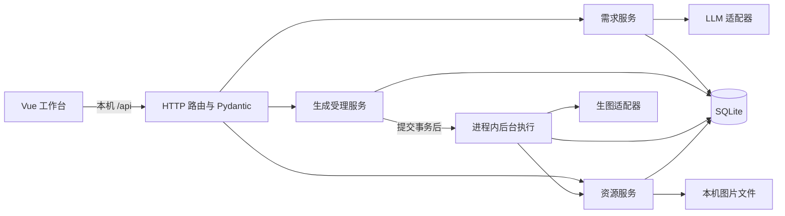

# 电商生图智能体后端设计 v1

状态：依据现有三份文档形成的后端设计草案；尚未实现应用、生成 OpenAPI 或完成真实模型联调。  
日期：2026-10-29。  
读者：后端开发者、前端接入开发者与编码智能体。  
依据：[SRS_v1.md](./SRS_v1.md)、[TECH_DESIGN_v1.md](./TECH_DESIGN_v1.md)、[FRONTEND_DESIGN_v1.md](./FRONTEND_DESIGN_v1.md)。

## 1. 使用本文

SRS 定义五项核心功能与产品验收；技术设计定义技术栈和本机执行方式；前端设计定义工作台行为。本文细化后端模块、事务、持久化及已有接口的完整数据契约，不新增产品功能或 API 路径。

原文已确定的约束继续有效。本文新增的响应字段、分页方式、修订号分配及本机限制是本次设计建议，供实现时采用，不表述为用户已逐项确认。供应商协议与能力仍按第 11 节待接入。

**目录以工作区 AGENTS.md 为准：** `main/` 保存应用源码；文档保存在 `vesion/v1/`，配置、测试、迁移和运行数据放在 `main/` 外。技术设计中的目录示意按第 2 节落实。三份输入文档保留原样；其中的实现步骤和启动命令属于设计资料，本次只交付本文。

| 实现分支 | 阅读位置 | 完成判据 |
|---|---|---|
| 启动、配置、路由装配 | 第 2–3 节 | 空模型配置可启动，历史可读，未知 API 不返回网页 |
| 数据、需求卡、对话 | 第 4–5 节 | 修订与确认有效，原文可恢复，晚到回复不能覆盖新状态 |
| 生成、去重、重启 | 第 6 节 | 同一提交只创建一个记录，执行使用快照，重启后无自动重发 |
| 上传、图片交付、重取 | 第 7 节 | 图片实际落盘，历史依赖保留，重取只获取原结果 |
| 前后端接入 | 第 8–9 节 | 已有各接口均有明确字段、空值、状态码和错误语义 |
| 实现与验收 | 第 10–11 节 | 关键受控检查通过，真实调用验收与未接入项分别记录 |

实现时先完成当前分支的判据，再推进依赖它的分支。接口实现后以 Pydantic 模型生成的 OpenAPI 为运行契约，前端同步 `api/types.ts`；契约若偏离本文，先更新相应设计与验收，避免维护两套含义。

## 2. 模块与工程位置

### 2.1 运行结构

沿用 Python 3.12、FastAPI、Uvicorn、Pydantic v2、pydantic-settings、SQLAlchemy 2、aiosqlite、Alembic、HTTPX、Pillow 与 python-multipart。后端单进程、一个 worker，只监听 `127.0.0.1`；生图使用进程内 `BackgroundTasks`，全局生图并发为 1。



`GET` 仅读取本机状态与文件。LLM 只在消息 POST 中调用；生图 `submit` 只由新受理记录的后台执行调用；结果重取走资源服务。路由和前端均不拼装供应商请求。

### 2.2 目标目录

以下为后续实现位置，本文不创建这些工程文件：

```text
工作区/
  AGENTS.md
  vesion/v1/                       # 需求与各设计文档
  main/
    backend/app/
      main.py                      # 应用工厂、lifespan、路由及网页入口
      settings.py                  # 定位外部配置，构造脱敏状态
      db.py                        # engine、session、短写事务
      models.py                    # 持久化实体与约束
      schemas.py                   # 请求、响应、LLM 输出模型
      routes.py                    # HTTP 适配与服务调用
      errors.py                    # 领域异常、错误码及异常处理器
      services/
        projects.py                # 项目创建、分页、详情组装
        briefing.py                # 对话整理、卡片、确认
        generation.py              # 去重受理、后台执行、启动修复
        assets.py                  # 上传、验证、落盘、下载、重取
      providers/
        contracts.py               # 供应商无关输入、输出与异常
        registry.py                # 显式注册与能力声明
        <选定供应商>.py            # 接入后创建
    frontend/                      # 前端应用源码，按前端设计实现
  backend/
    .env.example
    .env                           # 本机私有配置，不提交
    pyproject.toml
    uv.lock
    alembic.ini
    migrations/
    data/                          # 运行数据，不提交
      app.sqlite3
      references/
      generated/
      tmp/
  frontend/                        # 前端包管理、构建配置及 dist 产物
  tests/backend/                   # 受控测试与测试替身
```

包管理与启动在外部 `backend/` 进行，导入目录显式指向 `../main/backend`：Uvicorn 使用 `--app-dir`，pytest 在外部配置中设置 `pythonpath`，Alembic 根据自身文件位置解析源码路径。日常网页产物仍为工作区 `frontend/dist/`。这些路径通过绝对路径对象解析，运行不依赖调用者恰好位于某个目录。

路由只做输入解析、服务调用与响应映射；服务拥有事务和业务规则；适配器拥有鉴权、请求格式、远端状态与错误分类。首版直接使用服务和 SQLAlchemy，不另设通用仓储框架或多智能体框架。

### 2.3 适配器契约

| 调用 | 输入 | 输出与边界 |
|---|---|---|
| `LLMAdapter.organize(context)` | 已保存消息、当前 Brief、本次文字及参考图有无 | 第 5.2 节的 `NeedsInput / Review` 判别联合；一次完整返回 |
| `ImageAdapter.capabilities()` | 已加载的本地适配器声明 | 第 8.3 节能力及内部协议限制；不访问远端 |
| `ImageAdapter.submit(request)` | Generation 快照、完整提示词、固定尺寸、可选参考图路径；数量固定 1 | `ImageResult` 或 `RemoteTask(task_id)`；每次领取最多调用一次 |
| `ImageAdapter.poll(task_id)` | 原远端任务号 | `RemoteRunning / ImageResult / RemoteFailed`；只查已有任务 |

`ImageResult` 包含图片字节／可读流或已知结果定位信息，落地规则见第 7.2 节。正式请求只请求一张，成功结果要求恰好一张；多图响应按 `RESULT_FETCH_FAILED` 记录并保留可用定位信息。模型配置通过构造参数注入适配器，Key 不进入这些业务输入和返回值。

## 3. 配置与应用生命周期

### 3.1 配置来源

环境变量名称及初始值沿用技术设计第 4.1 节，不重复维护另一份字段清单。位置固定为工作区 `backend/.env`；`APP_DATA_DIR` 的相对路径以该 `backend/` 为基准。操作系统同名变量优先，修改后重启生效。

配置对象分 LLM、VISUAL、本机存储三部分。Key 使用 `SecretStr`；只在实际构造供应商请求时取明文。数据库、文件名、响应和日志中不保存 Key，状态接口以第 8.3 节的显式响应模型组装，不能序列化整个配置对象。

模型字段缺失、未知适配器、能力不符或尺寸无效时，应用保留诊断和历史读取能力，对应模型操作返回 `503`。数据库不可写、迁移未完成等本机基础设施错误则停止正常启动并提示处理，不能假装数据可持久化。

启动与配置 GET 只做本地字段、注册表和能力检查，不付费探测认证。精确协议由注册的适配器确定；`BASE_URL` 不是任意协议兼容开关。

### 3.2 生命周期顺序

1. 解析路径、配置与适配器声明，创建运行数据目录；确认单实例、单 worker 的运行约定。
2. 初始化数据库并检查 Alembic 版本。表结构由迁移维护，不以 `create_all()` 绕过迁移。
3. 在接受请求前执行第 6.5 节的中断修复。
4. 创建共享 `AsyncClient`、生图信号量和项目操作门闩；装配 API，再装配前端产物入口。
5. 关闭时停止接收新工作，按服务器关闭流程处理在途操作，最后关闭 HTTP 客户端与数据库。强制退出遗留状态由下次启动修复。

数据库每个连接启用 `PRAGMA foreign_keys=ON`，设置 `busy_timeout=5000` 毫秒；本机库使用 WAL。后两项是本次设计的本机默认值，不构成性能保证。正常运行前完成迁移，迁移时应用停止接收写请求。

开发通过 Vite 代理 `/api`；日常由 FastAPI 提供 `frontend/dist`。仅公开网页构建产物与资源 ID 路由，`.env`、数据库和图片目录不整目录挂载。未知 `/api/*` 返回统一 JSON 404；缺少前端产物时网页入口提示先构建，API 仍可诊断。

## 4. 领域对象、持久化与不变量

### 4.1 对象与字段

**Project** 是一个商品的持续制作记录；**Message** 是保存的用户文字、LLM 回复或系统中断说明；**Generation** 是一次单张生成尝试，包含失败与未知结果；**Asset** 是一份本机图片。可浏览的“图片版本”来自成功 Generation，版本号允许存在失败造成的间隔。

所有 ID 为服务端生成的 UUID，`request_id` 除外，由前端生成；SQLite 中按规范 UUID 字符串保存。时间使用有时区的 UTC，API 为 ISO 8601。各表字段如下；`?` 表示可空。

| 表 | 字段及职责 |
|---|---|
| `projects` | `id` 主键；`title`；`brief_json`；`revision`；`prompt_revision?`；`confirmed_revision?`；`brief_status`；`reference_asset_id?`；`brief_operation_id?`；`brief_error_code?`、`brief_error_message?`；`created_at`、`updated_at` |
| `messages` | `id` 主键；`project_id` 外键；`sequence_no`；`role`；`content`；`project_revision`；`operation_id?`；`brief_snapshot_json?`；`created_at` |
| `generations` | `id` 主键；`project_id` 外键；`version_no`；`request_id`；`request_payload_json`、`request_digest`；`confirmed_revision`；`status`、`stage`；`brief_snapshot_json`、`prompt`；`reference_asset_id?`；`adapter_id`、`model`、`provider_fingerprint`；`remote_task_id?`；`result_locator_json?`；`result_asset_id?`；`error_code?`、`error_message?`；`created_at`、`started_at?`、`completed_at?` |
| `assets` | `id` 主键；`project_id` 外键；`kind`；`relative_path`；`mime_type`；`width`、`height`；`byte_size`；`created_at` |

`brief_json` 保存需求文本、提示词和整理时尺寸；当前参考图的权威值为 `projects.reference_asset_id`，输出完整 Brief 时组合该字段。Message 的历史快照和 Generation 的提交快照均保存完整 Brief，不随当前项目变化。

`role` 为 `user / assistant / system`，`kind` 为 `reference / generated`。历史卡片只来源于有 `brief_snapshot_json` 的助手消息，不从普通回复文本倒推。消息按 `sequence_no` 升序，Generation 按 `version_no` 升序返回。

新建项目标题为“未命名项目”，修订为 0，需求状态为 `draft`，两个关联修订号和参考图均为空，文本字段为空、尺寸为空。首次保存有效用户文字时，用其折叠空白后的前 32 个字符设置标题；之后保持标题，无额外 LLM 命名调用。

`updated_at` 在项目持久化修改、整理结果和生图状态／交付变化时更新；GET 不更新它。需求修订与列表更新时间分别维护。

`provider_fingerprint` 是适配器标识、规范化服务地址和模型标识的摘要，不包含 Key，用于核对重取结果所需的原服务上下文。`result_locator_json` 是适配器定义的已知结果定位信息，不包含认证头或 API Key；可能含临时签名地址，仅供后端重取使用，不进入公开 DTO 或日志。

### 4.2 数据库约束

迁移建立以下约束与索引：

- 外键覆盖项目归属、参考资源和结果资源；服务同时校验资源属于当前项目且类型正确。
- `(project_id, sequence_no)`、`(project_id, version_no)`、`(project_id, request_id)` 分别唯一；版本号从 1 递增，失败记录不释放版本号。
- 部分唯一索引 `uq_project_active_generation`：`project_id` 在 `status IN ('queued','running')` 的记录中唯一。
- `revision >= 0`，关联修订号为空或不大于 `revision`；状态、角色和资源类型使用 CHECK 约束。
- 项目列表索引 `(updated_at, id)`；消息与生成列表分别使用项目 ID 加各自序号索引。

首版没有项目删除与自动清理历史的业务接口；替换引用不会级联删除历史资源。

### 4.3 事务与操作互斥

所有项目写操作先取得进程内项目操作门闩，忙时立即返回 `409 PROJECT_BUSY`，不排队执行过期用户操作。门闩覆盖该 HTTP 写操作，包含 LLM 整理与同步结果重取，并在 `finally` 释放。生成后台执行由已持久化的活跃状态锁定项目。读历史、GET 状态与下载不取得门闩。

门闩用于本进程请求协调；数据库版本检查和唯一约束仍为最终判定。已有 `request_id` 的匹配查询先于门闩和当前业务门槛，规则见第 6.1 节。

写事务使用新 session，通过统一 helper 在尚未开始读写的新事务上执行 `BEGIN IMMEDIATE`，读取当前状态后完成条件更新并尽快提交。SQLite 不按行锁方案实现 `SELECT FOR UPDATE`。外部模型、下载、信号量等待、图片解码期间均不持有数据库事务。

请求、后台执行和并发读取各用自己的 `AsyncSession`。受理事务提交后只把 Generation ID 交给后台；ORM 实例和请求 session 不跨生命周期传递。唯一约束竞争在回滚后用新事务重读，按“已有相同提交／活跃任务冲突”映射，不能一律抛 500。

## 5. 需求卡、对话与确认

### 5.1 Brief 与修订

完整 Brief 是以下唯一公共结构，当前卡片、历史卡片与生成快照共用它：

| 字段 | 类型与语义 |
|---|---|
| `product_description` | string，商品描述；确认前必须能识别商品主体 |
| `purpose` | string，图片用途，可使用自然语言 |
| `style` | string，画面风格，允许提出可见建议 |
| `composition` | string，构图和场景要求 |
| `text_content` | string，空字符串表示不要求加字 |
| `image_size` | string 或 null，规范为 `宽x高` 的精确方形像素；未配置时为空 |
| `reference_asset_id` | UUID 或 null，由服务端当前引用注入 |
| `prompt` | string，完整生图提示词；只读，空字符串表示尚无提示词 |

客户端可编辑前五个文本字段；后三个由后端管理。服务端接收用户原文，LLM 负责必要澄清、反馈约束保留和事实不编造；结构校验不能被描述为事实真实性保证。

修订只描述需求内容，不描述所有项目活动：

| 事件 | 修订与状态变更 |
|---|---|
| 保存一条用户消息并开始整理 | `revision += 1`；清空两种关联修订；进入 `organizing`，记录操作 ID |
| LLM 成功返回问题或卡片 | 再生成一个新 `revision`；`needs_input` 时两种关联修订为空；`review` 时 `prompt_revision = revision`，确认仍为空 |
| 卡片字段实际变化，或参考图引用变化 | `revision += 1`；清空两种关联修订；进入 `draft` |
| 用户确认 | 修订不变，`confirmed_revision = revision`，进入 `confirmed` |
| 整理失败／中断或生成状态变化 | 需求修订不变；整理错误回到 `draft`，生图状态独立维护 |

旧提示词文本可以保留供阅读，其有效性由 `prompt_revision` 决定。提交生成的必要版本关系为 `revision = prompt_revision = confirmed_revision`，且三者均非空。前端始终读取响应，不自行推算加一次数。

### 5.2 一次完整整理

1. 验证消息非空、期望修订匹配、项目无活跃生成，且 LLM 本地配置可用。明确未配置时不保存本次输入，前端保留未提交草稿。
2. 短事务保存用户原文、分配消息序号，按上表使旧确认失效并进入 `organizing`；提交后记录本次操作 ID 与修订 R。至此即使之后调用失败，用户原文也已保存。
3. 从已保存对话、当前卡片和本次用户意见构造 LLM 输入，只传参考图是否存在。输入中的文字是业务数据；结构化输出由服务端系统约束与 Pydantic 校验处理。
4. 在 `LLM_TIMEOUT_SECONDS` 的总时限内调用 `LLMAdapter.organize` 一次，不自动补发或发起“修复 JSON”的第二次模型调用。
5. 返回后开启新短事务，条件同时匹配项目 ID、修订 R、`organizing` 与操作 ID；匹配后保存助手回复和可还原的卡片快照，完成修订变更并清空操作 ID。条件失效返回 `409 STALE_ORGANIZATION`，原用户消息保留，晚到结果不应用。
6. 返回完整回复与最新 ProjectView。调用失败时仅由仍持有该操作 ID 的流程恢复为 `draft` 并保存脱敏错误，HTTP 为 `502/504`；刷新可通过详情取得错误。

`NeedsInput` 结构为 `{status: "needs_input", content: string, fields: PartialBriefFields|null}`；`Review` 为 `{status: "review", content: string, fields: BriefFields, prompt: string}`。`BriefFields` 为第 5.1 节前五个文本字段，部分字段对象允许缺席字段，已有字段仍为 string。服务端将需要补充信息的卡片提示词设为空；`Review` 必须有非空提示词。参考图 ID 与尺寸由服务端注入，不接受 LLM 自选资源、模型或输出尺寸。

商品主体、用户已提及的价格或活动信息有歧义时集中提问；未知材质、功能、认证和价格保持未指定，风格等可给出可见建议。反馈基于当前需求，保留用户未要求改变的文字约束；当前原始参考图继续沿用。适配器接入时核实上下文长度，无法容纳已保存需求时明确失败，不能静默丢弃约束来拼接输入。

尺寸取本次整理开始时已核实的 VISUAL 选择值；尚未配置时为 null。之后改变本机尺寸不会静默改写历史卡片，需要重新整理使新卡片与提示词一致。

### 5.3 编辑与确认

PATCH 保存卡片只更新允许编辑的字段；缺席字段不变，显式 null 无效。期望修订仍须校验。内容完全相同则返回当前状态，不增加修订，也不额外使确认失效。真正修改后按第 5.1 节转为 `draft`，不调用 LLM。

“重新整理”复用消息接口发送用户明确选择的整理指令，使用已保存卡片；“确认”是独立请求。确认检查当前修订、有效提示词、商品主体、无待澄清问题、尺寸已确定且与当前本机选择一致，并检查无冲突操作。确认同一有效修订可重复返回当前 ProjectView，不调用任何模型。

参考图存在但所选接口不支持时，可以保留需求查看；生成的能力门槛见第 6.2 节。服务端无法感知前端未发送文字或本地卡片草稿，这些操作门槛由前端设计第 8 节负责。

## 6. 生成受理、执行与恢复

### 6.1 请求身份与去重

请求体只有 `request_id`、`confirmed_revision` 与可选 `acknowledge_unknown`。先校验字段类型，再用 `(project_id, request_id)` 查询已有记录；即使项目目前已修改、又有新任务或当前模型未配置，也先处理该查询。

摘要输入是规范化的**原始请求**：项目 UUID、请求 UUID、整数确认修订，以及确认标记的“是否出现”和布尔值。使用键排序、稳定 JSON 编码后计算 SHA-256，并同时保存规范化 JSON。省略标记与显式 false 为不同原始参数；Pydantic 可通过 `model_fields_set` 保留该区别。

- 已有记录且规范化参数相同：`200` 返回原 Generation，不校验此刻需求或配置，不挂第二个后台任务。
- 已有记录而参数不同：`409 IDEMPOTENCY_CONFLICT`。
- 没有记录：按第 6.2 节受理，成功为 `202`。

比较依据不包含此刻的 Project 内容或配置。新 ID 表示新尝试，仍受活跃任务与未知结果确认约束。该机制只提供本机记录去重，不承诺远端计费具有严格 exactly-once 语义。

### 6.2 新提交的事务边界

取得项目门闩后，在短写事务中重新检查去重，再验证：项目无整理和活跃生成；需求满足第 5.1 节版本关系；VISUAL 配置、适配器和文生图能力可用；固定尺寸已核实且等于卡片尺寸；有参考图时资源有效、归属正确且接口支持参考图，并符合已声明限制。

最近一条 Generation 按最大 `version_no` 判断；若其为 `unknown`，新请求必须显式携带 `acknowledge_unknown=true`，否则 `409 UNKNOWN_ACK_REQUIRED`。旧未知记录始终保留，不因确认风险而改成失败。

同一事务分配 `max(version_no)+1`，保存完整需求快照、提示词、参考图、原请求、适配器／模型及服务指纹，创建 `queued` 记录并更新项目时间。提交后注册 `BackgroundTasks`，只传记录 ID，返回 `202`。若能明确捕获提交后的调度中断，将记录标为 `unknown`；不可观测的进程中断由启动修复处理。

### 6.3 后台执行与状态

| 状态 | 允许的后续状态 | 语义 |
|---|---|---|
| `queued` | `running`；中断时 `unknown` | 本机已持久化，等待执行机会 |
| `running` | `succeeded / failed / unknown` | 正在提交、查询同一远端任务或交付图片 |
| `succeeded` | 保持 | 对应成功落盘的结果；文件可用性另外读取 |
| `failed` | 仅符合重取条件时可转 `succeeded` | 明确失败；再次生成创建新记录 |
| `unknown` | 保持 | 是否产出结果不明；本版没有自动恢复远端任务 |

后台先获取全局生图信号量，等候期间保持 `queued`；获得执行机会后，以条件更新领取仍为 `queued` 的记录，写 `running` 和 `started_at`。领取失败直接退出，防止同一回调重复执行。所有输入从提交快照加载，不能读取后来编辑的卡片替代它。

从进入 `running` 开始，用 `VISUAL_TASK_TIMEOUT_SECONDS` 约束本次提交、远端查询和结果落地的总等待；排队时间不算供应商等待。HTTPX 分阶段超时同时配置，但其 read timeout 不能代替总时限。该上限是本机等待策略，不宣称能终止远端任务。

`stage` 仅表达已进入的阶段：`waiting_slot / submitting / waiting_remote / fetching_result / done`。同步接口跳过 `waiting_remote`；成功为 `done`，失败或未知保留最后实际阶段。阶段不是百分比，不根据耗时猜测远端进度。

执行只调用一次 `ImageAdapter.submit`，显式关闭 HTTPX transport 及供应商 SDK 的提交重试。异步接口得到远端任务号后立即持久化，再按适配器声明的周期查询同一任务；查询失败可在总时限内继续只读查询，永远不回到 `submit`。

### 6.4 结果分类

| 证据 | 记录结果 |
|---|---|
| 提交前发现本机引用文件缺失，或适配器能证明请求未提交 | `failed`，保存具体原因 |
| 供应商明确认证拒绝、限流、额度不足或明确任务失败 | `failed`，由适配器输出规范化错误 |
| 提交后断连、响应无法确认是否受理、查询耗尽总时限 | `unknown`，保留已知远端编号和最后阶段 |
| 已知远端成功，但下载、解码、尺寸校验或本机落盘失败 | `failed`，`RESULT_FETCH_FAILED`；保存已有定位信息 |
| 第 7 节文件交付事务完成 | `succeeded`，关联实际资源 |

适配器异常需携带 `not_submitted / rejected / uncertain / result_available` 的证据分类。不能仅把所有 HTTP 5xx、协议解析异常或写入超时解释为“明确未生成”。证据不足按 `unknown` 处理。

任务受理后的业务错误写入 Generation，查询仍返回 HTTP 200；只有本机读取失败、资源不存在等情况才使用该 GET 自身的 HTTP 错误。新尝试与失败均不覆盖旧成功结果。

### 6.5 重启修复

接受请求前，在一个短事务中：

- 将所有遗留 `queued/running` 改为 `unknown`，写 `PROCESS_INTERRUPTED` 和终态时间；快照、远端编号与已知定位信息保留。
- 将遗留 `organizing` 改为 `draft`，清空操作 ID 与两种关联修订，写 `ORGANIZATION_INTERRUPTED`；保留用户消息和旧卡片，可追加一次系统中断说明。

修复后读取历史，不调 LLM、不调 `submit`，不重新加入队列。`BackgroundTasks` 在事务提交与实际执行之间存在进程中断窗口，SQLite 保存记录不等于持久化调度。启动修复重复执行应无新增变化；远端原任务的查找与恢复留到具体供应商确认后评估。

## 7. 图片文件与结果重取

### 7.1 参考图上传

本次把 SRS 的 10 MB 明确为 **10,000,000 字节**；供应商有更低上限时取较小值。只接受一张实际 PNG 或 JPEG。类型声明和后缀仅作提示，最终以解码结果判断。

接收层在 multipart 解析前限制实际请求体：有效文件上限外加 64 KiB 协议预算；同时检查文件流的实际字节数，不能只相信 `Content-Length`。这是本机接收保护值，超限统一返回 `413`。多文件、字段不符、损坏图片或类型不符为 `422`。

先写 UUID 临时文件，Pillow `verify()` 后重新打开并 `load()`，读取实际 MIME 与尺寸；将解压炸弹警告视为校验失败。解码和文件操作移出事件循环执行，session 不传入工作线程。

校验完成后取得项目门闩，在短事务中再次校验修订和活动状态，将文件移动至 `references/`，插入 Asset 并更新当前引用及修订。失败保留旧有效图；移除只清空当前引用。上传、替换、移除均不调用模型，历史 Generation 依赖的文件保留。

### 7.2 结果落地与文件读取

Base64 在后端解码；远端结果按流读取并设置大小上限。首版本机单个生成文件上限默认 64 MiB，与供应商上限分别处理；接入时核对其是否覆盖所选尺寸。

下载只访问适配器认可的结果来源；不接受客户端任意图片 URL。结果 CDN 请求不沿用模型认证头，重定向目标逐跳验证。只交付适配器已核实、Pillow 可验证的栅格格式，扩展名由实际编码决定；返回 HTML 或文本不视为图片。

结果写入同一数据目录 `tmp/`，验证可完整打开、尺寸符合提交快照后，以 UUID 命名移动至 `generated/`，随后短事务插入 Asset、关联 Generation 并写 `succeeded`。文件系统与 SQLite 不能组成同一原子事务：顺序保证不会先写成功再尝试落盘；数据库提交失败留下的孤立文件不对外返回，后续维护可核对处理。

`relative_path` 为后端生成的相对路径，读取时解析后校验仍在数据目录内。GET 不暴露本机路径。文件缺失时保留历史元数据，响应中的 `availability=missing`；资源读取返回 `404 ASSET_FILE_MISSING`，不静默生成新图或在 GET 中修改任务状态。

资源预览按实际 MIME 返回，`download=true` 使用附件响应；命名为 `project-<项目ID>-v<版本号>.<实际扩展名>`，参考图使用资源 ID 命名。公开 Asset 不携带 Key、签名下载地址或原始文件名。

### 7.3 手动重取现有结果

重取接口选择**同步完成方式**：用户 POST 后等待本次下载完成，成功返回 `200 GenerationView`；不创建 Generation、不分配新版本、不扩展状态枚举。

允许条件为原记录 `failed` 且错误为 `RESULT_FETCH_FAILED`、存在可用定位信息，原适配器可用、当前服务指纹与原记录匹配、定位信息在已知有效期内，且项目无整理、活跃生成或其他写操作。条件由服务端计算，映射为 `can_retrieve_result` 与不可重取原因。没有定位信息的纯字节结果不能保证重新获取。

取得项目门闩后，在第 6.3 节等待上限内重新获取、验证和落盘，整个外部等待不持有数据库事务。执行期间记录仍为 `failed`，前端“正在重取结果”是本次请求的提示；其他冲突写操作返回 409。若另一个重取已经成功，重复 POST 返回现有成功记录。

成功更新同一记录为 `succeeded` 并清空错误；失败保持 `failed`，记录错误仍用 `RESULT_FETCH_FAILED`，接口按失败或超时返回 `502/504`，前端可 GET 核实。`completed_at` 表示最近一次终态落库时间。重取途径允许读取或换取**同一已知结果**，执行路径不包含 `ImageAdapter.submit`；断网、刷新和重启也不自动重取。

## 8. HTTP 与前端数据契约

### 8.1 通用规则与公共 DTO

请求／响应字段使用 snake_case。UUID、修订整数和布尔值严格校验；修订必须非负，布尔不接受字符串或整数。请求对象拒绝未定义字段，除 PATCH 缺席字段外，必要字段均必须出现。未知值使用 JSON null，列表无数据返回 `[]`。

统一使用第 9 节错误体，包括 FastAPI 默认验证异常、404 和未捕获异常。验证响应只输出安全字段位置与可操作说明，不回显原始请求、Key 或堆栈。本设计本机输入上限：单条消息 20,000 字符；卡片各可编辑字段 8,000 字符；完整提示词 32,000 字符。超出返回 422，不自动截断用户要求。

| DTO | 公开字段 |
|---|---|
| `AssetView` | `id, kind, mime_type, width, height, byte_size, created_at, availability`；最后一项为 `available / missing` |
| `ProjectView` | `id, title, revision, prompt_revision, confirmed_revision, brief_status, brief, reference_asset, brief_error, created_at, updated_at` |
| `MessageView` | `id, sequence_no, role, content, project_revision, brief_snapshot, created_at` |
| `GenerationView` | `id, project_id, version_no, request_id, confirmed_revision, status, stage, brief_snapshot, prompt, reference_asset_id, adapter_id, model, remote_task_id, result_asset_id, result_asset, error, can_retrieve_result, retrieval_unavailable_reason, created_at, started_at, completed_at` |

`brief` 和各 `brief_snapshot` 使用第 5.1 节 Brief；Message 无卡片时 `brief_snapshot=null`。`reference_asset` 和 `result_asset` 为 AssetView 或 null，缺失文件仍返回带 `missing` 的元数据。`brief_error` 与 `error` 为 `{code, message}` 或 null。`retrieval_unavailable_reason` 为安全原因文本或 null，不返回结果定位信息。公开远端编号必须是供应商任务标识，不是带认证参数的 URL。

ProjectView 不包含完整消息与生成记录；详情响应将三者组合。公开 DTO 使用字段白名单，不直接把 ORM 对象全部编码。

### 8.2 已有接口的精确输入与输出

路径保持技术设计第 7 节的十四种方法与路径：

| 方法与路径 | 请求 | 成功响应 |
|---|---|---|
| `GET /api/health` | 无 | `200 {"status":"ok"}`；检查本机应用与数据库可读性，不探测模型 |
| `GET /api/config/status` | 无 | `200 ConfigStatus`，结构见第 8.3 节 |
| `POST /api/projects` | 空 JSON 对象 `{}` | `201 ProjectView` |
| `GET /api/projects` | `limit=20`，范围 1–100；可选 `cursor` | `200 {items: ProjectSummary[], next_cursor: string\|null}` |
| `GET /api/projects/{id}` | 项目 UUID | `200 {project: ProjectView, messages: MessageView[], generations: GenerationView[]}` |
| `POST /api/projects/{id}/messages` | `{content: string, expected_revision: int}` | `200 {project: ProjectView, user_message: MessageView, assistant_message: MessageView}`；完整等待 LLM |
| `PATCH /api/projects/{id}/brief` | `{expected_revision: int, ...待修改文本字段}`；至少一个可编辑字段 | `200 ProjectView`；不整理、不确认 |
| `POST /api/projects/{id}/confirm` | `{revision: int}` | `200 ProjectView`；不生成 |
| `POST /api/projects/{id}/reference` | multipart：唯一 `file`，以及十进制整数字段 `expected_revision` | `200 ProjectView`；上传即替换当前引用 |
| `DELETE /api/projects/{id}/reference` | 查询参数 `expected_revision` | `200 ProjectView`；引用原本为空时为不增修订的成功空操作 |
| `POST /api/projects/{id}/generations` | `{request_id: UUID, confirmed_revision: int, acknowledge_unknown?: bool}` | 新记录 `202 {generation: GenerationView}`；相同原提交 `200` 同结构 |
| `GET /api/generations/{id}` | 生成记录 UUID | `200 GenerationView`，包括业务失败和未知状态 |
| `POST /api/generations/{id}/retrieve-result` | 空 JSON 对象 `{}` | 同步重取完成 `200 GenerationView`；细则见第 7.3 节 |
| `GET /api/assets/{id}` | `download=false`，可选 true | `200` 文件流；附件／预览由该参数决定 |

传输层查询参数和 multipart 字段由文本解析为目标类型；严格布尔规则针对 JSON 请求体。所有 mutation 成功响应均是提交后的实际状态。`409`、写请求超时或回执无法确认时，由前端保留本地内容并 GET 核实，服务端不提供通用写请求自动重试。

`ProjectSummary` 为 `id, title, brief_status, latest_generation_status, updated_at`；无生成时对应状态为 null。列表按 `(updated_at DESC, id DESC)` 排序，游标编码上一页末项的 UTC 时间与 UUID，解析校验失败返回 422。取 `limit+1` 条判断下一页，末页 `next_cursor=null`。

列表是实时读取，不提供跨页数据库快照；项目更新时间变化可能影响跨页位置，前端按 ID 去重并在重新加载列表时从首批读取。详情返回本项目全部历史；本版单用户范围暂不增加消息和版本的分页接口。

消息序号、修订号和 `request_id` 提供三种关联：消息卡片由 `brief_snapshot` 还原；生成图对应提交快照；待核实提交由详情中的 `request_id` 精确关联。查看旧图片或旧消息不恢复当前需求。

### 8.3 只读配置状态

`ConfigStatus` 顶层为 `{llm: LLMConfigStatus, visual: VisualConfigStatus}`。两个角色共同字段：

| 字段 | 类型与语义 |
|---|---|
| `configured` | bool，必需配置字段是否完整 |
| `ready` | bool，本地字段、适配器和所需能力校验是否通过；不代表认证成功 |
| `adapter_id`、`model` | string 或 null |
| `missing_fields` | string[]，仅字段名称 |
| `issues` | `{code, message}[]`，安全的本地校验原因 |
| `timeout_seconds` | 正整数，本机对应操作总等待上限；排队另计 |
| `verification` | 固定为 `not_checked`，表示此接口不提供真实认证探测证据 |

VisualConfigStatus 另有 `capabilities` 对象：

| 能力字段 | 类型与语义 |
|---|---|
| `text_to_image`、`reference_image`、`asynchronous` | bool 或 null；false 是明确不支持，null 是未确定 |
| `supported_image_sizes` | string[] 或 null，适配器核实的精确方形尺寸 |
| `selected_image_size` | string 或 null，本机选择的规范尺寸 |
| `reference_mime_types` | string[] 或 null，供应商已核实的输入类型 |
| `provider_max_reference_bytes` | 正整数或 null；null 表示供应商字节上限尚未核实 |
| `effective_reference_max_bytes` | 正整数，本机 10,000,000 与已知供应商上限取小值 |

适配器未注册时能力为未知；空配置下仍返回本机上传上限。若供应商没有独立字节限制，以官方可确认的输入约束说明为依据记录在适配器实现中，不能把“尚未查到”当成“无限制”。

不返回 BASE_URL、Key、原始配置、结果签名 URL 或持久认证成功标记。前端会话内实际调用成功／失败可作为本次提示，不把 `ready=true` 写成“连接成功”。这些字段补齐 FE-DEP-01、FE-DEP-06，不增加配置写入或付费测试接口。

## 9. 错误与可观察性

统一错误响应：

```json
{"error":{"code":"REVISION_CONFLICT","message":"需求已更新，请读取最新记录后再操作。"}}
```

| HTTP | 主要错误码 | 处理边界 |
|---|---|---|
| 404 | `PROJECT_NOT_FOUND / GENERATION_NOT_FOUND / ASSET_NOT_FOUND / ASSET_FILE_MISSING / ROUTE_NOT_FOUND` | 区分记录不存在与已有文件丢失 |
| 409 | `REVISION_CONFLICT / PROJECT_BUSY / ACTIVE_GENERATION_EXISTS / STALE_ORGANIZATION` | 保存本地内容，读取最新状态，不合并过期提交 |
| 409 | `IDEMPOTENCY_CONFLICT / UNKNOWN_ACK_REQUIRED / BRIEF_NOT_READY / IMAGE_SIZE_CHANGED / RESULT_NOT_RETRIEVABLE / RETRIEVE_CONFIG_CHANGED` | 保留原记录，按明确门槛处理 |
| 413 | `UPLOAD_TOO_LARGE` | 上传字节超限，在模型调用前阻止 |
| 422 | `VALIDATION_ERROR / INVALID_REFERENCE_IMAGE / UNSUPPORTED_REFERENCE_FORMAT / REFERENCE_NOT_SUPPORTED / INVALID_CURSOR` | 定位字段或图片；能力不支持时允许用户移除参考图 |
| 503 | `MODEL_NOT_CONFIGURED / ADAPTER_UNAVAILABLE / MODEL_CAPABILITY_MISMATCH / DATABASE_BUSY / LOCAL_STORAGE_UNAVAILABLE` | 指明模型角色或本机原因；不泄露配置值 |
| 502 | `LLM_CALL_FAILED / LLM_RESPONSE_INVALID / RESULT_FETCH_FAILED` | 同步操作失败；若原文已保存，可 GET 恢复 |
| 504 | `LLM_TIMEOUT / RESULT_FETCH_TIMEOUT` | 仅对应同步整理／重取请求，不代表可取消远端工作 |
| 500 | `INTERNAL_ERROR` | 返回安全通用说明，内部按关联 ID 记录原因 |

Generation 的 `error.code` 还可包含规范化 `VISUAL_AUTH_FAILED / VISUAL_RATE_LIMITED / VISUAL_QUOTA_EXCEEDED / VISUAL_TASK_FAILED / VISUAL_OUTCOME_UNKNOWN / PROCESS_INTERRUPTED / REFERENCE_FILE_MISSING`；`RESULT_FETCH_FAILED` 按第 7.3 节计算可重取性。这些是记录中的业务结果，状态 GET 为 200。

日志记录项目 ID、生成 ID、请求 ID、阶段、耗时及规范化错误码，足以定位本机执行链路。默认不记录完整对话、提示词、图片 Base64、供应商原始响应或带签名 URL；认证信息先脱敏，HTTP 客户端调试日志不直接启用。无实际测量时不生成费用、百分比或剩余时间。

## 10. 实现顺序与验证

### 10.1 交付步骤

| 顺序 | 工作 | 完成判据 |
|---|---|---|
| 1 | 源码与外部配置目录、lifespan、迁移、健康与配置接口 | 空模型配置不影响启动和本机诊断；目录遵守 AGENTS.md |
| 2 | Project／Message／Asset、上传、资源读取与分页 | 修订、归属、文件校验和历史保留成立；FE-DEP-02、FE-DEP-05 有真实 Schema |
| 3 | LLM 契约、整理、历史卡片、确认 | 澄清和反馈可以恢复；失败保留原文；过期回复无法提交 |
| 4 | Generation、原请求去重、后台执行与中断修复 | 并发不绕过约束；提交快照不可变；刷新与重启不重发 |
| 5 | 已知结果重取、异常映射和前端字段联调 | FE-DEP-03、FE-DEP-04 可从实际响应验证；重取供应商提交次数为零 |
| 6 | 两个真实供应商适配器与闭环验收 | SRS 规定的真实无图、有图、反馈重生、文件下载均通过 |

先用临时 SQLite、临时图片目录和可计数的适配器替身验证事务及失败分支；替身只在 `tests/backend/`，正式服务没有模拟成功回退。检查采用外部 `backend/pyproject.toml` 配置运行 Ruff 与 pytest；具体命令在工程落地后写入启动说明，不把本设计的目标目录当作已存在工程。

### 10.2 必须覆盖的检查

| 编号 | 受控场景 | 可观察的通过条件 | 对应要求 |
|---|---|---|---|
| BE-AC-01 | 空配置启动、分别缺少角色配置、错误 Key | 历史可读；对应操作明确失败；响应、日志、文件与数据库无 API Key | SRS AC-01、08、13 |
| BE-AC-02 | 澄清、保存卡片、重新整理、确认 | 消息原文保留；修订按第 5 节变化；保存不整理，确认不生成 | SRS AC-04、05；FE-AC-04 |
| BE-AC-03 | 两个并发整理或提交过期回复 | 一个操作获得处理权；旧回复不能覆盖当前修订，用户原文保留 | FE-AC-07、17 |
| BE-AC-04 | 上传错误后缀、伪装 MIME、损坏／过大图片及多文件；无 Content-Length 的超大体 | 解析和解码均受限，正确 413/422；旧图与模型调用次数不变 | SRS AC-09；FE-AC-06 |
| BE-AC-05 | 替换／移除参考图后生成；尝试引用别项目图片 | 旧确认失效；新请求使用当前合法参考图；历史图仍可读，越项目引用拒绝 | SRS AC-03、05、09 |
| BE-AC-06 | 并发相同 ID、不同 ID；同 ID 改参数；省略确认标记改为 false | 相同原请求只一个 Generation 和一次 submit；其他竞争按错误码拒绝 | SRS AC-06；FE-AC-07 |
| BE-AC-07 | 终态后修改需求和配置，再恢复旧原提交 | 返回原记录和原快照，不按当前状态重建或再次 submit | FE-AC-10、11 |
| BE-AC-08 | 异步轮询短暂失败、提交后断连、等待超时 | 查询始终同一远端 ID；明确失败与 unknown 分开；不自动重新提交 | SRS AC-06、08 |
| BE-AC-09 | 第一版成功，第二版失败／成功；读取旧版 | 版本号不复用；新旧快照正确；旧文件均可打开 | SRS AC-07；FE-AC-08、09 |
| BE-AC-10 | 整理或生成中刷新，随后重启；重复执行启动修复 | 只有 GET；中断状态修复一次；启动模型调用次数为零 | SRS AC-10、11、12；FE-AC-14 |
| BE-AC-11 | unknown 后新 ID 提交，先缺少确认再确认 | 缺少确认被拒，显式确认后才创建新记录，原未知记录仍可查 | FE-AC-15 |
| BE-AC-12 | 下载失败、无效图片、重取、重取同时再生成 | 保存已知定位；重取不增版本且 submit 次数不变；冲突被拒 | SRS AC-08；FE-AC-16 |
| BE-AC-13 | 成功后删除本机结果文件、尝试路径越界 | 元数据显示 missing；资源 GET 404；数据目录外不可读取 | FE-AC-19 |
| BE-AC-14 | 项目多页、历史卡片、待核实原请求关联 | 游标终止明确，卡片快照可还原，request_id 可精确匹配原记录 | FE-DEP-02、03、05 |
| BE-AC-15 | 日常静态入口、未知 API、缺少前端产物 | 正常网页可用；未知 API 为 JSON 404；配置与数据目录不可直接访问 | SRS AC-14 |

真实验收继续以 SRS 第 7 节为准：AC-01、02、03、07 使用实际配置的两类 API，验证纯文字、参考图、反馈重生，以及在浏览器外打开下载文件。结构校验、适配器替身与可打开的占位图均不能替代真实验收。

## 11. 接入待定项与资料

### 11.1 供应商接入判据

| 待定项 | 接入前必须获得的证据 | 完成判据 |
|---|---|---|
| LLM 地址、模型、鉴权、输出协议 | 官方接口文档与用户本机配置；对应 SRS OPEN-01 | 完整回复通过判别联合校验，真实澄清与需求整理成功 |
| VISUAL 两条输入链路 | 官方文生图、参考图生图协议与支持模型；对应 OPEN-02 | 当前参考图字节实际进入生成请求，无图路径也真实成功 |
| 尺寸、格式、字节与等待限制 | 官方模型能力、提交／查询／结果格式；对应 OPEN-03 | 适配器能力与配置状态可准确显示，所选方形结果可落盘 |
| 异步任务及结果重取 | 官方任务号、状态、轮询频率、结果来源与有效期 | poll 只查同一任务；retrieve 只取已知结果；无法保证的恢复能力明确关闭 |

API Key 始终由用户填入本机 `.env`，不写入本文。尚未确定的协议不预设为某家兼容 API；尚未核实的能力用未知值表达。供应商未定不妨碍本机框架实现，但不能标记整个 v1 已完成。

### 11.2 官方事实依据

以下资料在编写本文时联网核对，用于划定实现边界；具体参数仍以接入时锁定版本和供应商文档为准：

- [FastAPI Background Tasks](https://fastapi.tiangolo.com/tutorial/background-tasks/)：响应后执行与进程内后台任务的适用范围，不能提供持久队列恢复保证。
- [SQLAlchemy AsyncSession 并发](https://docs.sqlalchemy.org/en/20/orm/extensions/asyncio.html#using-asyncsession-with-concurrent-tasks)：每个并发任务使用独立 session。
- [SQLite Transactions](https://www.sqlite.org/lang_transaction.html)：`BEGIN IMMEDIATE` 提前取得写事务，其他写连接可能产生 `SQLITE_BUSY`。
- [HTTPX Transports](https://www.python-httpx.org/advanced/transports/)：transport 可配置连接重试，生图提交需显式检查并关闭相关重试层。
- [Pillow Image](https://pillow.readthedocs.io/en/stable/reference/Image.html)：图片打开、完整加载、验证及解压炸弹限制。

