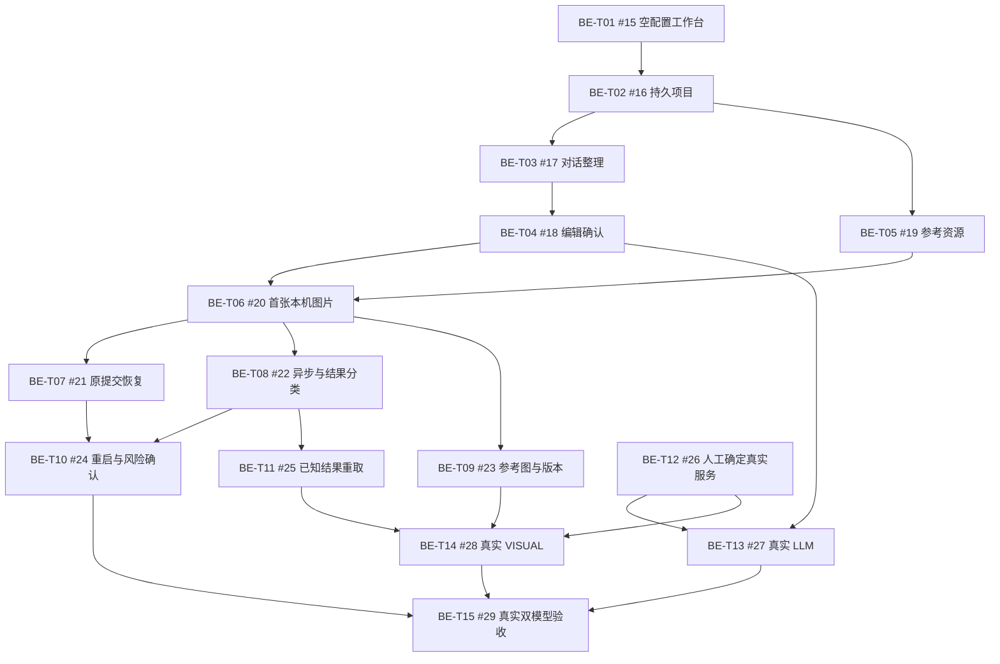

# 电商生图智能体 v1 后端任务拆分

来源：[父 Issue #14：实现电商生图智能体 v1 后端持久化、生成执行与恢复](https://github.com/sixpence6/main/issues/14)。日期：2026-10-29。

状态：用户已确认拆分；15 张任务票已发布为父 Issue #14 的子 Issue（#15–#29）。14 张使用 ready-for-agent，人工前提票 #26 使用 ready-for-human。已核对全部正文、标签、父子关系和 20 条原生阻塞关系。BE-T01–15 是本次拆分标识，对应实际 Issue 见下方。

## 拆分约定

- 每张实现票贯通一条可演示或可验证的用户路径：真实数据/迁移、服务、HTTP、现有工作台的必要接入和行为测试随路径交付，不单拆数据库层、路由层或测试层。
- 现有前端已有集中客户端与工作台入口，后端尚未落地；无需先做广泛预重构。BE-T01 通过实际空配置诊断路径建立运行基础，后续新增模型采用可迁移扩展，不搬迁前端或重建外壳。
- 沿用已确认的完整 FastAPI HTTP 测试边界，真实临时 SQLite 和图片目录，供应商边界受控；进程重启和 202/后台时序使用真实单 worker 服务验证。受控成功只在测试，正式服务如实报缺配置。
- 各票增量核验本路径的实际 OpenAPI/响应与集中前端映射；最终统一核验 FE-DEP-01–06。源码、依赖、测试、配置及运行数据均遵守父规格和项目目录约定。
- BE-T12 是现有 OPEN-01–03 的人工选型/资料前提，标为 ready-for-human；其余 14 张实现/验收票标为 ready-for-agent。BE-T12 可与 BE-T01 同时开始，只阻塞真实协议接入，不阻塞本机业务实现。凭据仅由用户留在本机，不能进入票据。
- 原提交恢复、异步结果分类、版本制作在首图路径之后分别推进；重启恢复与结果重取各自只依赖必要前置。只登记直接阻塞边，不重复可传递依赖；共 20 条，无循环。
- 已按依赖顺序发布为 #14 的子 Issue，并建立 GitHub 原生阻塞关系；已核对父 Issue 的标题、正文、标签、状态和评论均保持原样。既有 #13 的完整浏览器验收继续独立跟踪，最后一票只验收本后端规格并交接证据。

## 任务清单

1. **BE-T01：打开本机空配置工作台并读取真实诊断状态**  
   **Blocked by：** 无，可立即开始。  
   **交付：** 启动真实后端，打开已有工作台，看到两类模型的只读配置状态；无配置仍能诊断。  
   **标签：** ready-for-agent。  
   [已发布 #15](https://github.com/sixpence6/main/issues/15)

2. **BE-T02：创建项目、分页浏览并在重启后读取原记录**  
   **Blocked by：** BE-T01（[#15](https://github.com/sixpence6/main/issues/15)）。  
   **交付：** 首个有效操作创建真实项目，分页浏览和 URL 恢复读取同一持久记录，重启后仍可查看。  
   **标签：** ready-for-agent。  
   [已发布 #16](https://github.com/sixpence6/main/issues/16)

3. **BE-T03：保存对话原文并完成澄清、需求卡与整理恢复**  
   **Blocked by：** BE-T02（[#16](https://github.com/sixpence6/main/issues/16)）。  
   **交付：** 文字经整理得到澄清问题或完整需求卡；失败和整理中断后原文、快照与错误可读回。  
   **标签：** ready-for-agent。  
   [已发布 #17](https://github.com/sixpence6/main/issues/17)

4. **BE-T04：编辑保存需求卡、主动重新整理并独立确认**  
   **Blocked by：** BE-T03（[#17](https://github.com/sixpence6/main/issues/17)）。  
   **交付：** 保存不调用 LLM，实际修改使旧提示词失效；重新整理后才能确认同一版本，确认不生图。  
   **标签：** ready-for-agent。  
   [已发布 #18](https://github.com/sixpence6/main/issues/18)

5. **BE-T05：上传、替换和移除参考图并交付真实本机资源**  
   **Blocked by：** BE-T02（[#16](https://github.com/sixpence6/main/issues/16)）。  
   **交付：** 单张有效参考图实际落盘并可预览下载；替换失败保留旧图，移除不删除旧资源。  
   **标签：** ready-for-agent。  
   [已发布 #19](https://github.com/sixpence6/main/issues/19)

6. **BE-T06：按确认需求生成首张本机图片并预览下载**  
   **Blocked by：** BE-T04（[#18](https://github.com/sixpence6/main/issues/18)）、BE-T05（[#19](https://github.com/sixpence6/main/issues/19)）。  
   **交付：** 确认后提交持久生成快照，后台按快照执行，首张图片验证落盘后才能预览下载。  
   **标签：** ready-for-agent。  
   [已发布 #20](https://github.com/sixpence6/main/issues/20)

7. **BE-T07：回执丢失后恢复原提交并处理并发身份冲突**  
   **Blocked by：** BE-T06（[#20](https://github.com/sixpence6/main/issues/20)）。  
   **交付：** 用同一 request_id 和完整原参数恢复既有记录，当前需求或配置改变也不重建或再生成。  
   **标签：** ready-for-agent。  
   [已发布 #21](https://github.com/sixpence6/main/issues/21)

8. **BE-T08：查询同一远端任务并区分失败、交付失败和结果未知**  
   **Blocked by：** BE-T06（[#20](https://github.com/sixpence6/main/issues/20)）。  
   **交付：** 异步轮询只查询原任务；根据证据区分明确失败、交付失败和 unknown，保留已有信息。  
   **标签：** ready-for-agent。  
   [已发布 #22](https://github.com/sixpence6/main/issues/22)

9. **BE-T09：携带原参考图生成、反馈重生并逐版下载**  
   **Blocked by：** BE-T06（[#20](https://github.com/sixpence6/main/issues/20)）。  
   **交付：** 当前原始参考图实际进入生成输入，反馈保留未修改约束，新旧成功图片都能读取下载。  
   **标签：** ready-for-agent。  
   [已发布 #23](https://github.com/sixpence6/main/issues/23)

10. **BE-T10：进程重启后只读恢复并确认未知结果风险后再生成**  
   **Blocked by：** BE-T07（[#21](https://github.com/sixpence6/main/issues/21)）、BE-T08（[#22](https://github.com/sixpence6/main/issues/22)）。  
   **交付：** 重启将遗留任务标为 unknown，保留快照且不重跑；接受风险后才能创建新的尝试。  
   **标签：** ready-for-agent。  
   [已发布 #24](https://github.com/sixpence6/main/issues/24)

11. **BE-T11：手动重取已知结果并恢复同一图片版本**  
   **Blocked by：** BE-T08（[#22](https://github.com/sixpence6/main/issues/22)）。  
   **交付：** 交付失败后手动获取同一已知结果，原版本更新成功，不新增生成或再次提交。  
   **标签：** ready-for-agent。  
   [已发布 #25](https://github.com/sixpence6/main/issues/25)

12. **BE-T12：确定两类真实模型服务、协议和能力约束**  
   **Blocked by：** 无，可立即开始。  
   **交付：** 由用户确定实际 LLM/VISUAL 服务，整理可核验的协议、尺寸和限制，解开真实适配器前提。  
   **标签：** ready-for-human。  
   [已发布 #26](https://github.com/sixpence6/main/issues/26)

13. **BE-T13：接入真实 LLM 完成澄清、反馈整理与需求确认**  
   **Blocked by：** BE-T04（[#18](https://github.com/sixpence6/main/issues/18)）、BE-T12（[#26](https://github.com/sixpence6/main/issues/26)）。  
   **交付：** 选定 LLM 经真实消息/卡片路径运行，错误和约束保留有实际证据。  
   **标签：** ready-for-agent。  
   [已发布 #27](https://github.com/sixpence6/main/issues/27)

14. **BE-T14：接入真实 VISUAL 完成无图、有图生成与文件交付**  
   **Blocked by：** BE-T09（[#23](https://github.com/sixpence6/main/issues/23)）、BE-T11（[#25](https://github.com/sixpence6/main/issues/25)）、BE-T12（[#26](https://github.com/sixpence6/main/issues/26)）。  
   **交付：** 选定视觉协议真正接收文字或原参考图，交付一张本机文件，能力与重取限制有来源。  
   **标签：** ready-for-agent。  
   [已发布 #28](https://github.com/sixpence6/main/issues/28)

15. **BE-T15：完成真实双模型闭环与后端持久化验收**  
   **Blocked by：** BE-T10（[#24](https://github.com/sixpence6/main/issues/24)）、BE-T13（[#27](https://github.com/sixpence6/main/issues/27)）、BE-T14（[#28](https://github.com/sixpence6/main/issues/28)）。  
   **交付：** 双真实模型跑通纯文字、参考图和反馈重生，验证文件、刷新、重启和全部后端契约。  
   **标签：** ready-for-agent。  
   [已发布 #29](https://github.com/sixpence6/main/issues/29)

## 阻塞关系

当前可开始的前沿为 BE-T01（[后端启动 #15](https://github.com/sixpence6/main/issues/15)）和 BE-T12（[人工选型 #26](https://github.com/sixpence6/main/issues/26)）；同一代码模块可能需要协调修改，但这本身不作为业务阻塞边。

## 覆盖核对

| 父规格要求 | 对应交付 |
|---|---|
| BE-AC-01 | BE-T01；真实角色核验 BE-T13/14；总验收 BE-T15 |
| BE-AC-02 | BE-T03/04；真实整理 BE-T13 |
| BE-AC-03 | BE-T03/04 |
| BE-AC-04 | BE-T05 |
| BE-AC-05 | BE-T05/09；真实参考图 BE-T14 |
| BE-AC-06 | BE-T06/07 |
| BE-AC-07 | BE-T07 |
| BE-AC-08 | BE-T08；真实异步/错误 BE-T14 |
| BE-AC-09 | BE-T09 |
| BE-AC-10 | 整理恢复 BE-T03；完整进程恢复 BE-T10 |
| BE-AC-11 | BE-T10 |
| BE-AC-12 | 交付失败/定位 BE-T08；重取 BE-T11；真实能力 BE-T14 |
| BE-AC-13 | 参考资源 BE-T05；结果资源 BE-T06/08/11 |
| BE-AC-14 | 项目分页 BE-T02；消息/快照 BE-T03/09；原请求 BE-T07；完整契约 BE-T15 |
| BE-AC-15 | BE-T01 |
| FE-DEP-01–06 | 随各路径增量核验；BE-T15 汇总真实 OpenAPI/运行响应 |
| SRS OPEN-01–03 | BE-T12 人工前提；BE-T13/14 真实适配；BE-T15 真实闭环 |

## 发布记录

15 份发布正文、实际 Issue 编号及 20 条原生阻塞边已保存在本次拆分的本地记录中；已逐一读取远端核对正文、标题、标签和阻塞关系，并核对全部子 Issue 属于 #14。发布前草案保留供追溯，实际票据与阻塞关系以上方 Issue 链接和 GitHub 原生关系为准。
