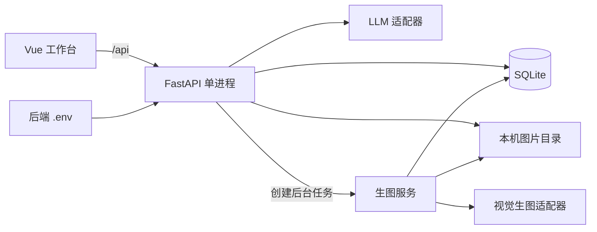

# 电商生图智能体技术设计 v1

状态：技术方案已确认；模型供应商与具体协议待选定。  
日期：2026-10-28  
产品需求：[SRS_v1.md](./SRS_v1.md)。

## 1. 使用范围与执行规则

本文供开发者与编码智能体实现本机自用的电商生图工具。SRS 定义产品范围和验收目标，本文定义工程、数据、接口与执行方式；修改行为时同步两份文档的相关条目。

本次交付是设计文档，尚未创建应用代码、安装依赖或完成真实 API 联调。下文目录、接口与命令是后续实现约定。

用户已确认：Vue + FastAPI 前后端分离；仅本地部署；历史持久化；Key 仅在后端 `.env` 配置；生图后台执行、页面轮询；重启不自动重跑未完成任务；LLM 完整返回；日常由 FastAPI 提供构建后的前端。

模型服务商尚未确定。可以先完成应用、适配器契约与受控测试；真实生图验收必须等待具体接口接入。空配置时应明确提示未配置，测试替身仅用于测试。

## 2. 技术栈

| 层次 | 选择 | 用途及边界 |
|---|---|---|
| 前端 | Vue 3、TypeScript、Vite | Composition API、`<script setup>`，单页工作台 |
| 组件 | Element Plus | 表单、上传、对话记录、需求卡、状态及版本展示 |
| 状态 | Vue `ref` / `reactive` 与一个工作台 composable | 首版不需要 Router、Pinia；当前项目标识放 URL 查询参数，业务数据由后端恢复 |
| HTTP | 浏览器 `fetch` + 集中封装 | 请求与错误处理放 `src/api/`，统一使用相对 `/api` 地址 |
| 后端 | Python 3.12、FastAPI、Uvicorn | 单个 worker、仅监听 `127.0.0.1` |
| 校验与配置 | Pydantic v2、pydantic-settings | 请求、LLM 输出和配置校验，加载后端 `.env` |
| 外部调用 | HTTPX `AsyncClient` | 异步调用模型与下载远端图片；供应商特殊 SDK 封装在适配器内 |
| 数据 | SQLite、SQLAlchemy 2、aiosqlite | 异步数据库访问；Alembic 管理建表与后续迁移 |
| 图片 | 本机文件、Pillow、python-multipart | 图片校验、尺寸读取、上传与文件交付 |
| 后台执行 | FastAPI `BackgroundTasks` | 生图请求响应后在同一进程执行，不提供跨进程队列或重启续跑保证 |
| 工具与检查 | npm、uv；vue-tsc、Vitest；Ruff、pytest、pytest-asyncio | 依赖锁定、类型检查及有针对性的状态与接口测试 |

前端使用官方 `create-vue` 创建项目；Node 使用满足所锁定 Vite `engines` 的受支持 LTS。初始化时锁定兼容版本并提交 `package-lock.json`、`uv.lock`，不在本文猜测未来最新小版本。Vite 构建不能代替 `vue-tsc` 类型检查。

## 3. 运行架构与目录



开发时 Vite 监听 `127.0.0.1:5173`，将 `/api` 代理到 `127.0.0.1:8000`。前端通过代理请求后端，首版无需开放通配 CORS。

日常先构建 Vue，由 FastAPI 在 `127.0.0.1:8000` 提供 `frontend/dist` 与 API。仅网页构建产物公开；数据库、`.env` 和图片目录不整目录挂载。图片通过资源 ID 访问。注册 API 路由后再提供前端入口，未知 `/api/*` 返回 JSON 404，不能落入网页入口。

约定目录：

```text
project/
  SRS_v1.md
  TECH_DESIGN_v1.md
  .gitignore
  frontend/
    package.json
    package-lock.json
    vite.config.ts
    src/
      App.vue
      components/          # 模型状态、对话、需求卡、上传、结果与历史
      composables/useProject.ts
      api/client.ts
      api/types.ts
  backend/
    .env.example
    .env                  # 本机配置，不提交
    pyproject.toml
    uv.lock
    alembic.ini
    migrations/
    app/
      main.py             # lifespan、路由、前端静态入口
      settings.py
      db.py
      models.py
      schemas.py
      routes.py
      services/
        briefing.py
        generation.py
        assets.py
      providers/
        contracts.py
        registry.py
    tests/
    data/                 # 不提交
      app.sqlite3
      references/
      generated/
      tmp/
```

`routes.py` 负责 HTTP，服务层负责需求确认、任务状态与交付，适配器负责供应商协议。供应商请求格式不能散落在路由和 Vue 组件中。

## 4. 配置与模型接入

### 4.1 后端环境配置

`backend/.env.example` 提供以下字段，Key、地址、模型及适配器初始留空：

```dotenv
LLM_ADAPTER=
LLM_BASE_URL=
LLM_API_KEY=
LLM_MODEL=
VISUAL_ADAPTER=
VISUAL_BASE_URL=
VISUAL_API_KEY=
VISUAL_MODEL=
VISUAL_IMAGE_SIZE=
LLM_TIMEOUT_SECONDS=60
VISUAL_TASK_TIMEOUT_SECONDS=300
APP_DATA_DIR=./data
```

超时是初始实现默认值，接入时按实际接口调整；不是速度承诺。`VISUAL_IMAGE_SIZE` 在供应商确定后填写其支持的一种方形尺寸，不预填未经核实的值。

以代码位置解析 `backend/.env` 绝对路径，避免受终端工作目录影响。`APP_DATA_DIR` 的相对路径以 `backend/` 为基准。操作系统同名环境变量优先于 `.env`；修改后重启生效。

Key 使用 `SecretStr`，不写入数据库、日志或错误响应；`.env` 与 `data/` 加入忽略规则。网页只读配置状态，没有配置写入接口。前端构建变量中不放 Key。

`GET /api/config/status` 仅返回各角色的配置状态、模型名称、适配器标识、缺失字段名称及能力信息；不返回 Key 或原始配置对象。配置完整不等于真实认证成功，启动与状态查询均不自动付费调用模型。

### 4.2 供应商适配契约

| 接口 | 应用层输入 | 应用层输出 |
|---|---|---|
| `LLMAdapter.organize` | 已保存对话、当前需求卡、参考图是否存在 | 经 Pydantic 校验的 `needs_input` 或 `review` 回复；包含问题或需求卡与完整提示词 |
| `ImageAdapter.capabilities` | 本地适配器定义 | 文生图、参考图输入、异步查询、支持尺寸等能力 |
| `ImageAdapter.submit` | 已确认需求快照、提示词、可选本机参考图、尺寸 | 图片数据／结果定位信息，或远端任务编号 |
| `ImageAdapter.poll` | 已存在的远端任务编号 | 运行中、成功结果或明确失败；仅异步供应商实现 |

`API_KEY`、`BASE_URL`、`MODEL` 是配置，不是通用协议。选定供应商后新增对应模块并注册 `ADAPTER`；根据官方文档确定鉴权、路径、JSON/multipart 字段、返回格式及超时。首版不自动猜测某家兼容协议。

LLM 仅处理文字，参考图由后端传给生图适配器。生图接口必须通过有图、无图两条真实链路验收。异步远端任务的轮询周期由适配器按供应商约束设置，与页面每 2 秒查询本机状态是两件事。

## 5. 数据模型与文件

技术命名中，`Project` 是一个商品的持续制作记录，`Generation` 是其中一次单张生成尝试，`Asset` 是一份本机图片。SRS 中的历史任务对应 Project，后台执行任务对应 Generation。

| 表 | 必需字段 |
|---|---|
| `projects` | UUID、标题、当前需求卡 JSON、`revision`、`prompt_revision`、`confirmed_revision`、`brief_status`、当前参考图 ID、创建及更新时间 |
| `messages` | UUID、项目 ID、角色、文字内容、创建时间；保存用户原文、澄清回复与修改意见 |
| `generations` | UUID、项目 ID、版本号、`request_id`、请求摘要、状态、需求快照 JSON、提示词、参考图 ID、适配器及模型标识、远端任务编号、可重取的结果定位信息、结果资源 ID、错误码、脱敏错误说明、创建及完成时间 |
| `assets` | UUID、项目 ID、类型 `reference/generated`、相对文件路径、实际 MIME、尺寸、字节数、创建时间 |

需求卡结构：`product_description`、`purpose`、`style`、`composition`、`text_content`、`image_size`、`reference_asset_id`、`prompt`。图片文字可为空，表示不要求加字。未知商品事实保持未指定。

需求或参考图每次变化递增 `revision`，清空 `prompt_revision` 与 `confirmed_revision`，将旧提示词标为过期。LLM 返回有效卡片和提示词后，同一事务保存新版本，并设置 `prompt_revision = revision`。确认时要求提示词属于当前版本，再设置 `confirmed_revision = revision`。提交生成时三个版本必须相等；Generation 保存完整快照，之后不随 Project 的修改变化。

LLM 返回结果前，校验请求开始时的项目版本仍有效。用户或其他标签页已修改时返回冲突，保留对话，不用过期回复覆盖新需求。

数据库启用外键。`(project_id, version_no)`、`(project_id, request_id)` 分别唯一；用部分唯一索引约束每项目最多一个活跃生成任务：

```sql
CREATE UNIQUE INDEX uq_project_active_generation
ON generations(project_id)
WHERE status IN ('queued', 'running');
```

项目 ID 非空。版本号分配、请求去重与任务创建在同一短事务中完成。后台任务自行创建 `AsyncSession`；不复用请求依赖中即将关闭的 session，也不跨并发任务共享 session。等待远端模型时不持有数据库事务。

上传文件先校验格式、实际可解码性及大小，再以 UUID 命名保存。有效上限取 SRS 的 10 MB 与供应商限制中较小值。原始文件名不作为存储路径。

生成图片先写 `tmp/`，验证后在同一数据目录内移动到最终位置，再写入资源记录并标记成功。成功状态必须对应实际存在的文件；读取时发现缺失则显示文件缺失，不伪造成功下载。替换当前参考图只改变引用，保留历史生成依赖的文件。

## 6. 对话、后台执行与重启

### 6.1 LLM 整理

保存用户消息并使旧提示词和确认失效，再异步调用 LLM；页面显示整理中，不做 SSE 或逐字输出。以保存输入后的项目版本作为此次调用的期望版本，返回时通过事务内条件更新校验版本，保存回复、需求卡和提示词，再完整返回。`needs_input` 回复不产生有效提示词版本。

`brief_status` 使用 `draft / organizing / needs_input / review / confirmed`。失败保留原文；刷新时从项目详情恢复，仍在整理中则查询项目状态，不自动再调用 LLM。后端启动时将遗留 `organizing` 恢复为 `draft` 并提示整理中断，由用户手动重试。

编辑需求卡时保存结构化字段，旧提示词与确认失效，不能仅修改字段后继续确认旧提示词。用户点击“重新整理”，复用消息接口发送“按当前需求卡重新整理”的指令，由 LLM 更新卡片和完整提示词后再次展示、确认。首版提示词只读；生成始终使用确认时显示的同版本提示词。

### 6.2 生图执行

1. Vue 生成一个 UUID `request_id`，发送项目确认版本。网络断开后重试提交仍使用同一 ID；主动再次生成才创建新 ID。
2. 后端先按项目与 `request_id` 查询已有记录，比对规范化的原始请求参数摘要；相同则返回已有任务，不同则返回 `409`。仅新请求继续校验配置、能力、卡片／提示词／确认版本、参考图及未知结果确认；事务内再次检查去重与活跃任务，保存快照和 `queued` 记录，数据库唯一约束处理并发竞争。
3. 提交事务后，用 `BackgroundTasks` 启动生图服务，响应 `202` 与 Generation ID。前端约每 2 秒调用状态接口。
4. 后台任务使用全局异步信号量将生图并发限制为 1；等候任务保持 `queued`。获得执行机会后标记 `running` 并调用 `submit` 一次。
5. 同步供应商等待该次请求；异步供应商保存远端编号、查询同一任务。HTTPX/SDK 的生图提交自动重试关闭，轮询不能调用 `submit`。
6. 获取并验证本机图片后标记 `succeeded`；明确拒绝标记 `failed`；提交后断连、结果不明或远端等待超时标记 `unknown`。

同一 `request_id` 与相同输入返回已有 Generation，即使此时项目需求或模型配置已经变化。请求摘要根据原始请求参数计算，不能使用此刻的项目内容或配置重新计算。换 ID 也不能绕过同项目活跃任务约束。该机制用于本机去重，不宣称远端调用具有严格的 exactly-once 保证。

轮询只在当前选中项目有活跃任务时运行，同一时间只发出一个查询；切换项目、终态或组件卸载时清理定时器及未完成读取。停止轮询不会取消后台生成；刷新或选择历史项目只发 GET，不再次 POST 生图。

### 6.3 状态与重启

| 状态 | 含义及用户动作 |
|---|---|
| `queued` | 已持久化，等待本进程执行机会 |
| `running` | 正在调用模型、查询远端结果或落地图片 |
| `succeeded` | 图片已持久化，可预览与下载 |
| `failed` | 明确失败；保留原因和旧版本，用户可主动发起新任务 |
| `unknown` | 结果未确认；保留快照及远端编号，禁止自动重发 |

应用启动时、开始接受请求之前，将数据库残留的 `queued/running` 标为 `unknown`，不把它们重新加入后台任务。已成功项目、对话和文件照常读取。

若项目最近一条生图记录为 `unknown`，界面说明原请求可能已计费；用户主动再次生成须显式确认，请求携带 `acknowledge_unknown=true`，使用新 `request_id`。远端结果找回能力在供应商确定后评估，本版不承诺自动恢复。

供应商已成功但本机下载失败时，保存可重取的结果定位信息，使用 `failed` 与 `RESULT_FETCH_FAILED`。用户可重取同一结果；成功后转为 `succeeded`，不得调用 `submit`。无可用定位信息时明确说明无法重取。

固定一个 Uvicorn worker，应用只运行一个实例。`BackgroundTasks` 不是持久队列，SQLite 保存的是记录；重启恢复记录不等于恢复执行。首版不引入 Redis、Celery、多进程或分布式调度。

## 7. API 契约

API 返回时间使用 UTC ISO 8601，界面按浏览器本地时区显示。请求与响应由 Pydantic 定义，以 FastAPI OpenAPI 为接口来源；前端类型集中于 `api/types.ts`，接口变更同步更新并运行类型检查。

| 方法与路径 | 作用与关键输入 |
|---|---|
| `GET /api/health` | 检查本机服务，不访问外部模型 |
| `GET /api/config/status` | 读取脱敏配置状态与能力 |
| `POST /api/projects` | 创建制作项目 |
| `GET /api/projects` | 分页读取历史项目，按更新时间倒序 |
| `GET /api/projects/{id}` | 恢复需求、对话、当前参考图及生成记录 |
| `POST /api/projects/{id}/messages` | `content`、`expected_revision`；保存消息，完整返回 LLM 回复及新版本 |
| `PATCH /api/projects/{id}/brief` | `expected_revision`、结构化需求字段；修改后使提示词与确认失效，需重新整理 |
| `POST /api/projects/{id}/confirm` | 确认指定 `revision`；提示词过期或缺少必要信息时拒绝 |
| `POST /api/projects/{id}/reference` | multipart 文件与 `expected_revision`；保存图片，替换当前引用并使确认失效 |
| `DELETE /api/projects/{id}/reference` | 查询参数 `expected_revision`；移除当前引用并使确认失效，保留历史文件 |
| `POST /api/projects/{id}/generations` | `request_id`、`confirmed_revision`、可选 `acknowledge_unknown`；创建或返回已有后台任务 |
| `GET /api/generations/{id}` | 查询状态、阶段、结果资源 ID、脱敏错误；轮询使用 |
| `POST /api/generations/{id}/retrieve-result` | 用户手动重取已知结果；仅重新下载，不重新生成 |
| `GET /api/assets/{id}` | `download=false/true`；按实际 MIME 预览或使用附件响应下载 |

当前项目 ID 使用 URL 查询参数 `?project=<uuid>`，刷新后读取详情恢复；无参数时展示历史入口或创建新项目。浏览器不持久化完整任务状态、Key 或图片 Base64。

统一错误体：`{"error":{"code":"...","message":"..."}}`。使用 `404` 表示资源不存在，`409` 表示版本冲突、活跃任务冲突或未知结果未确认，`413` 表示上传过大，`422` 表示格式或内容无效，`503` 表示对应模型未配置或适配器不可用，`502/504` 表示同步 LLM 调用失败或超时。

生图请求已被接受后，其后续错误写入 Generation，由 GET 返回任务状态；不能将后台失败伪装成该次 GET 的 HTTP 错误。错误说明保留可操作信息，过滤认证头、Key、原始供应商配置和响应中的敏感信息。

前后端都校验生成前置条件；服务端拒绝未确认或过期版本。整理或生成期间，当前项目的新消息、需求和参考图修改暂时禁用；服务端也检查活动状态，防止其他标签页绕过。查看历史与下载旧图保持可用。

## 8. 实现顺序与完成条件

| 步骤 | 工作 | 完成条件 |
|---|---|---|
| 1 | 创建 Vue、FastAPI 工程，配置代理、静态入口、依赖锁及 `.env.example` | 两种运行模式下健康与只读配置接口可访问；空配置可启动 |
| 2 | 建表迁移、资源存储、项目历史与版本校验 | 上传、替换、移除、刷新及重启后读取记录通过测试；历史依赖文件保留 |
| 3 | 实现 LLM 契约、需求卡与确认流程 | 测试替身可验证澄清、确认失效和过期回复冲突；真实适配待供应商确定 |
| 4 | 实现生成记录、幂等提交、后台任务、轮询及重启修复 | 并发提交去重、未知状态处理、文件交付及旧版本保留通过受控测试 |
| 5 | 接入实际两类 API 并走完整流程 | 按 SRS 通过真实文生图、参考图生图、反馈重生与下载验收 |

步骤 1–4 完成只表示应用骨架和本机流程具备测试基础；供应商未配置时不标记整个 v1 已完成。每一步处理完其完成条件再进入下一步。

## 9. 验证与启动约定

重点测试：并发与同 ID 重试只提交一次；需求变化后重试旧 ID 仍返回原任务；编辑卡片使旧提示词及确认失效；后台任务使用提交快照；远端超时与重启不自动重发；未知结果重新生成需确认；参考图实际进入适配器；下载失败后重取不再次生图；已有图片重启后仍可下载；网页和错误响应不泄露 Key。

后端使用临时 SQLite 和临时图片目录，替换适配器进行受控异常测试。前端用 Vitest 验证轮询清理、恢复后不重发、错误时保留旧图等状态行为；真实 API 验收由用户本机配置完成，不把实际 Key 写进测试。

以下命令在应用实现后提供，当前文档工作不会执行它们。前端应定义 `dev`、`build`、`typecheck`、`test` 脚本；后端提供迁移配置。

前端初始化及检查，在 `frontend/`：

```powershell
npm ci
npm run typecheck
npm run test -- --run
npm run build
```

后端初始化及检查，在 `backend/`：

```powershell
uv sync --locked
uv run alembic upgrade head
uv run ruff check .
uv run pytest
```

开发分别运行：

```powershell
# frontend/
npm run dev -- --host 127.0.0.1
# backend/，另一个终端
uv run uvicorn app.main:app --host 127.0.0.1 --port 8000 --reload
```

前端已构建、依赖及迁移已完成后，日常在 `backend/` 只运行：

```powershell
uv run uvicorn app.main:app --host 127.0.0.1 --port 8000 --workers 1
```

访问 `http://127.0.0.1:8000`。真实生图联调用日常模式，避免开发自动重载中断任务。后端无法找到前端构建产物时，API 仍可诊断，网页入口明确提示先构建前端。

## 10. 官方事实依据与剩余接入事项

已查阅的官方依据：

- [Vue Quick Start](https://vuejs.org/guide/quick-start.html#creating-a-vue-application)：官方脚手架、Vite 与可选功能。
- [Vue TypeScript](https://vuejs.org/guide/typescript/overview.html)：SFC 类型检查与构建的区别。
- [FastAPI async/await](https://fastapi.tiangolo.com/async/) 与 [Background Tasks](https://fastapi.tiangolo.com/tutorial/background-tasks/)：异步 I/O 与进程内后台任务。
- [FastAPI 进程内存](https://fastapi.tiangolo.com/deployment/concepts/#memory-per-process)：多个 worker 的内存不共享。
- [SQLAlchemy AsyncSession](https://docs.sqlalchemy.org/en/20/orm/extensions/asyncio.html#using-asyncsession-with-concurrent-tasks)：并发任务独立 session。
- [Pydantic dotenv](https://docs.pydantic.dev/latest/concepts/pydantic_settings/#dotenv-env-support)：显式文件路径与环境变量优先级。
- [SQLite 部分唯一索引](https://www.sqlite.org/partialindex.html#unique_partial_indexes)：活跃任务的数据库约束。

接入前仍需实际模型名称、公开接口文档、支持的参考图格式及输出尺寸、鉴权与返回协议、超时和远端状态查询能力。届时先核对官方资料，再实现两个具体适配器；这些待定项不改变已确认的本地技术架构。
