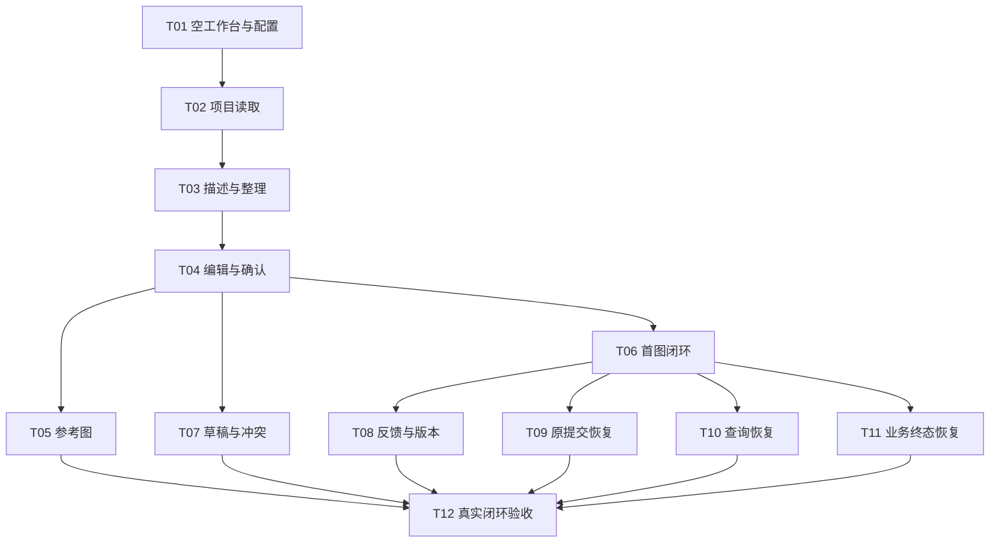

# 电商生图智能体 v1 前端任务拆分

来源：[父 Issue #1](https://github.com/a13295877929-gif/main/issues/1)。日期：2026-10-29。

状态：用户已确认拆分；12 张任务票已发布为父 Issue #1 的子 Issue（#2–#13），均带 ready-for-agent 标签。已核对 12 份正文、父子关系和 16 条原生阻塞关系。T01–T12 是本拆分的标识，对应实际 Issue 链接见下方。

## 拆分范围与共同约定

- 沿用父规格的前端范围。每票沿用户行为贯穿契约类型、集中 HTTP 消费、工作台状态、可见交互及完整工作台测试；不把源码、API 封装或样式各拆成单独的横向票。后端、数据库和供应商适配器仍为外部依赖。
- 当前无应用代码，无需预重构。T01 以可实际演示的空配置诊断路径建立工作台和测试基础，后续票复用其入口。
- 所有票沿用已确认的 Vitest 完整工作台／HTTP 边界，检查用户可见结果与必要请求，不直接测试内部状态动作；键盘、错误和保留输入要求随每条路径交付，T12 汇总真实浏览器和模型验收。
- 应用源码位于 main，配置、测试、文档和其他辅助资料放在外部。测试替身仅用于测试环境；无可用服务时正式界面如实报缺配置／接入限制。
- FE-DEP-01–06 在相关票逐步记录实际响应映射，T12 必须全部核验；后端草案的候选字段不视为已落地契约。
- 已按拓扑顺序发布为 #1 的子 Issue，统一 ready-for-agent 标签并使用 GitHub 原生阻塞关系。已核对父 Issue 的正文、标题、标签和状态保持原样。只建立直接必需依赖，不重复登记可传递依赖。

## 任务清单

1. **T01：打开空配置工作台并查看只读模型状态**  
   **Blocked by：** 无，可立即开始。  
   **交付：** 三种视口下可打开的工作台、只读配置抽屉、诚实空态及首条工作台／HTTP 测试。  
   [已发布 #2](https://github.com/a13295877929-gif/main/issues/2)

2. **T02：浏览已有项目并只读恢复对话与需求**  
   **Blocked by：** T01。  
   **交付：** 项目分页、选中和链接恢复到保存的消息、需求及真实状态，导航不调用模型。  
   [已发布 #3](https://github.com/a13295877929-gif/main/issues/3)

3. **T03：首次描述创建项目并完成澄清与需求整理**  
   **Blocked by：** T02。  
   **交付：** 有效首消息才创建项目，经 LLM 完整回复形成问题或需求卡，失败保留原文并可读回。  
   [已发布 #4](https://github.com/a13295877929-gif/main/issues/4)

4. **T04：编辑需求卡、单独保存整理并确认**  
   **Blocked by：** T03。  
   **交付：** 本地编辑／取消、保存失效、主动重新整理、同版本确认；保存不调用 LLM，确认不生图。  
   [已发布 #5](https://github.com/a13295877929-gif/main/issues/5)

5. **T05：上传、替换与移除单张参考图**  
   **Blocked by：** T04。  
   **交付：** 单图验证、上传优先创建项目、真实保存状态和修订失效，失败保留旧图及无图退路。  
   [已发布 #6](https://github.com/a13295877929-gif/main/issues/6)

6. **T06：按已确认需求生成首图并预览下载**  
   **Blocked by：** T04。  
   **交付：** 已确认文字需求明确提交一次，经基本状态查询得到可预览下载资源，含防重与待核实安全阻塞。  
   [已发布 #7](https://github.com/a13295877929-gif/main/issues/7)

7. **T07：安全切换项目、保留草稿并处理版本冲突**  
   **Blocked by：** T04。  
   **交付：** 脏草稿离开确认、取消恢复 URL／输入、旧读写响应隔离，以及 409 后保留副本和主动加载最新。  
   [已发布 #8](https://github.com/a13295877929-gif/main/issues/8)

8. **T08：反馈重生、浏览历史版本并逐版下载**  
   **Blocked by：** T06。  
   **交付：** 首图后反馈、再次确认生成、新旧版本独立预览下载；旧图不恢复旧需求，新图不打断主动选择。  
   [已发布 #9](https://github.com/a13295877929-gif/main/issues/9)

9. **T09：断网刷新后核实并恢复原次生成提交**  
   **Blocked by：** T06。  
   **交付：** 最小会话凭据、只读核实和用户明确同 ID／同参数恢复，存储损坏或丢失不自动新生图。  
   [已发布 #10](https://github.com/a13295877929-gif/main/issues/10)

10. **T10：查询断连、页面隐藏与重启后的只读恢复**  
    **Blocked by：** T06。  
    **交付：** 自动查询单路、连续三次读取失败暂停、手动 GET 恢复及页面可见性／重启行为。  
    [已发布 #11](https://github.com/a13295877929-gif/main/issues/11)

11. **T11：未知结果确认后再生成与现有结果重取**  
    **Blocked by：** T06。  
    **交付：** 服务端 unknown 后明确风险确认的新生成，以及 RESULT_FETCH_FAILED 只重取同一结果的独立路径。  
    [已发布 #12](https://github.com/a13295877929-gif/main/issues/12)

12. **T12：真实 API 联调与浏览器完整闭环验收**  
    **Blocked by：** T05、T07、T08、T09、T10、T11。  
    **交付：** 真实文字／参考图／反馈闭环及文件、刷新／重启、键盘和三种视口验收，全部接口依赖有核验记录。  
    [已发布 #13](https://github.com/a13295877929-gif/main/issues/13)

## 依赖图

## 直接依赖理由

| 任务 | 为什么这些票真正阻塞它 |
|---|---|
| T01 | 无既有代码或前置任务，第一条只读用户路径可直接开始 |
| T02 | 需要工作台、集中 HTTP、配置与测试入口 |
| T03 | 复用项目详情／URL 恢复；创建回执不明时已有项目核实入口必须可用 |
| T04 | 需要真实整理结果、当前卡片和服务端修订上下文 |
| T05 | 参考图变化要接入已经可用的需求失效、整理与确认路径 |
| T06 | 首次生成必须基于已完成的需求确认与修订门槛；纯文字路径不等参考图上传 |
| T07 | 要保护文字草稿和卡片编辑缓冲，需具备两种修改路径及服务端冲突响应 |
| T08 | 需要已有首图、可再次调用的生成路径和资源下载；保留当前参考字段不依赖上传入口 |
| T09 | 需要生成提交身份、受理记录和最小凭据基础；与服务端 unknown 恢复分开 |
| T10 | 需要已有生成状态读取／基本单路调度，才能验证连接失败和生命周期恢复 |
| T11 | 需要已有生成记录、业务终态和资源显示；不依赖客户端是否收到回执 |
| T12 | 收齐全部用户分支与恢复路径后才可证明完整前端验收；其余祖先由这些叶子传递保证 |

## 覆盖矩阵

| 父规格验收 | 主要任务 |
|---|---|
| FE-AC-01 | T01；T12 实际浏览器检查 |
| FE-AC-02 | T01、T06 |
| FE-AC-03 | T01、T02、T03、T05 |
| FE-AC-04 | T03、T04 |
| FE-AC-05 | T04、T05 |
| FE-AC-06 | T05 |
| FE-AC-07 | T03、T04、T06 |
| FE-AC-08 | T06、T08；T05 的参考输入由 T12 验证实际进入模型 |
| FE-AC-09 | T08 |
| FE-AC-10 | T06 基础阻塞，T09 完整恢复 |
| FE-AC-11 | T09 |
| FE-AC-12 | T10 |
| FE-AC-13 | T02、T06 基础隔离／清理，T07、T10 完整路径 |
| FE-AC-14 | T02、T03、T06 基础只读恢复，T09、T10 异常恢复，T12 重启联调 |
| FE-AC-15 | T11 |
| FE-AC-16 | T11 |
| FE-AC-17 | T04 基础拒绝，T07 完整冲突路径 |
| FE-AC-18 | T07 |
| FE-AC-19 | T01–T06、T08、T11 各自错误路径；T12 汇总 |
| FE-AC-20 | 各任务随交互实现键盘／焦点，T12 验证实际浏览器体验 |
| FE-AC-21 | T02 |
| FE-AC-22 | T12 |

| 用户故事编号 | 主要任务 |
|---|---|
| 1–10 | T01、T02、T03 |
| 11–17 | T03；首次参考上传为 T05 |
| 18–25 | T03、T04 |
| 26–32 | T05、T06、T08 |
| 33–37 | T06 |
| 38–45 | T06、T08 |
| 46–50 | T02、T07 |
| 51–53 | T01；后续真实调用证据由对应用户路径更新 |
| 54–57 | T09、T10 |
| 58–60 | T10 |
| 61–62 | T11 |
| 63–65 | T07、T10、T11 及各自错误路径 |
| 66–68 | 各票随路径交付，T01 奠定外壳规则，T12 实际浏览器验证 |
| 69–70 | T12；其余票均如实标明受控测试与真实联调状态 |

## 发布与推进

已按 T01–T12 顺序创建 #2–#13，并通过 GitHub 读取接口核对父子关系、16 条原生依赖、ready-for-agent 标签和正文一致性。任务正文的交叉引用使用实际 Issue 链接；原生关系已表达阻塞，正文省去重复的 Blocked by 段。

当前 frontier 只有 T01／[#2](https://github.com/a13295877929-gif/main/issues/2)。T04／#5 完成后，T05／#6、T06／#7、T07／#8 可分别推进；T06／#7 完成后，T08–T11／#9–#12 各自解锁。

T12 还有明确外部前提：运行后端、真实 OpenAPI、两类模型本机配置及支持参考图的生图能力。缺少这些条件时保留未验收状态，不能用现有 12 张前端票内部的依赖关系冒充外部条件已经满足。
